# Architecture and how it works

This page explains which programs OffiCraft runs on your machines, what a member actually is, how status is determined, where data is stored, how handovers and updates work, and which layer is responsible when something goes wrong.

## Overall structure

OffiCraft consists of one server (the main program) plus one warden on each machine (a background program that starts and stops members on that machine). The server stores all data and decides which members should be online and which should stop; the warden starts or stops members on its own machine as the server instructs; each member is a Claude Code or Codex session that stays connected to the server through a small tool called ocagent. You operate everything through the console web page.

The diagram and the text below use three kinds of connection: REST is an ordinary request-and-response web request; SSE (Server-Sent Events) is a connection that stays open so the server can push new messages as soon as they happen; MCP (Model Context Protocol) is a standard format that lets AI call outside tools, and members use MCP to give the server commands.



Every connection in the diagram goes to the server. Members do not talk to each other directly, and they do not depend on being on the same machine: chat, reply cards, and tasks all go through the server, so members on different machines can work together.

The console web page also talks to the server in two ways: actions you send (signing in, sending messages, pressing buttons) go over REST, and updates arrive over a long-lived SSE connection. New chat messages, new reply cards, and task progress appear on screen directly, without a manual refresh. When the SSE connection drops, a "Live updates disconnected" banner appears above the tab bar, meaning the screen may not be up to date; "Reload" on the banner reloads the page.

## The three programs

| Program | Where it runs | What it does |
| --- | --- | --- |
| **ocserverd** (server) | The machine OffiCraft is installed on | Stores identities, chat, reply cards, tasks, lore, secrets, and settings, in a local SQLite database (database software that keeps the whole database in a single file). Provides REST, SSE, and MCP interfaces and serves the console web page. Only accepts connections from the same computer (`127.0.0.1`); this cannot be changed. Every 30 seconds it compares "should each member be online or stopped" with the actual state and gives the warden commands when needed. |
| **warden** | One per machine, always running in the background | Only carries out the server's commands: starts and stops members on this machine, reports this machine's status (CPU, memory, disk, Claude / Codex version and login status, and the Claude account and usage it looked up with Anthropic), and keeps itself and ocagent on the latest version. The warden does not decide on its own whom to start, and it is not an AI. |
| **ocagent** | Inside each member's session | The tool between the member and the server: keeps the long-lived SSE connection to the server and passes notifications into the member's conversation, uploads and downloads attachments, fetches secrets, reports memory use and activity status, and reports whether model calls succeed or fail. |

On macOS, the warden is started by a small program called `officraft`. `officraft` itself is never replaced by automatic updates, so macOS permission settings (such as permission to access files) stay valid after every update; when macOS shows a permission prompt, `officraft` is the name you see.

## What a member is actually running

Each member has one tmux session on the machine it is assigned to. tmux is a tool that keeps terminal programs running in the background so you can attach to them later and look. "Terminal · TMUX" in the member details gives the command to attach to that session; run it in your own terminal to see the member's screen.

- **Claude Code members**: the tmux session runs `claude` on your machine. When the warden starts it, it has Claude Code load the OffiCraft notification module. The module first sends the boot instructions, then starts `ocagent listen`, and from then on passes each notification the server pushes into the member's main conversation as a prompt. The skills, plugins, and MCP servers you set up in Claude Code (all of them Claude Code extensions) still work.
- **Codex members**: the tmux session runs a Codex process provided by the warden. It runs `codex app-server` in the background together with `ocagent listen`, and turns each notification it receives into one Codex conversation turn. Whether the member is online depends only on the `ocagent listen` connection, not on whether anyone is attached to the screen.

Both kinds of member use the Claude or Codex account already logged in on that machine. When a Claude member starts, the warden takes the login that member will use and asks Anthropic which account it is; the member's usage and estimated cost are then counted against that account until the member restarts. The account's usage figures are looked up by the warden in the same way, not reported by the member itself. A member's identity, role, and memory are not stored in the session but on the server, so a session can end at any time and a new session can pick up from there.

## Member permission settings

Members are sessions running in the background, and there is no one to click a permission prompt if one appears, so both runtimes are started with permission prompts skipped:

- Claude Code is started with `--dangerously-skip-permissions`.
- Codex is started with `approvalPolicy: never` plus `sandbox: danger-full-access`.

The cost is that members have broad control over your machine. What limits a member's behavior is the working rules it reads, and the rule that "anything you need to decide goes on a reply card", not permission control at the system level. For the same reason, Claude Code's built-in `AskUserQuestion` tool, which pops up an interactive menu, is disabled.

## Whether a member uses Claude Code or Codex

Newly added staff and the built-in Mira start with no AI runtime chosen. The "Claude Code" shown in the launch settings is only the default display value; sending it unchanged does not save it.

The actual runtime is decided when the member is dispatched to a machine and started: if Claude Code is available on that machine, Claude Code is used; if Claude Code is not available but Codex is, Codex is used. Once decided, it stays fixed for that member.

In the following cases, the member starts with Claude Code this time, but the choice is not saved, and it is decided again at the next start:

- The warden on that machine has not reported its capabilities yet.
- `codex` is installed but not logged in, so it does not count as available.
- Claude Code on that machine is installed but logged out. Codex is not used automatically in this case, because once a choice is saved it never changes automatically; after that machine logs in to Claude again, the member can start with Claude Code.

Members upgraded from older versions already have Claude Code saved as their runtime, and this does not change automatically.

Change "AI runtime" in the launch settings to the other option and confirm, and the selected runtime is saved and fixed. For a member with no runtime chosen yet, the screen already shows Claude Code, and confirming it unchanged does not save it. For what to do when a member cannot start on a machine that only has Codex installed, see "The machine has only Codex, and Mira or a new member will not start" in [Troubleshooting and FAQ](troubleshooting.md).

## How member status is determined

**Whether a member is online** depends on one thing only: whether the member's `ocagent listen` is connected to the server's SSE right now. Connected means online; disconnected means not online. There is no separate heartbeat or timeout check, and the console, the monitoring page, and other members looking at the roster all see the same status. A member can have only one connection at a time; when a second one connects, the old one is cut off.

The dot at the bottom right of the avatar has five states:

| State | Meaning |
| --- | --- |
| Waking | The server has sent the start command and is waiting for the member to connect. If it does not connect within about two minutes, this wake counts as failed, and the reason is written in "Last operation" in the member details. |
| Online | The member's connection is up. |
| Stopping | A stop has been requested; the member is still wrapping up and its connection is still up. |
| Stopped | A stop has been requested and the connection is closed. The server does not bring it back on its own. |
| Offline | No one asked the member to stop, but the connection dropped (for example, the program exited or the machine went offline). As long as the member is set to be online, the server wakes it again in the next comparison round. |

**Activity status** is something else: it shows what the member is doing right now: Working, Waiting (on a background command, a monitor, or a schedule), or Idle; before the member reports, it shows "Status unknown". The data comes from Claude Code hooks (programs Claude Code runs automatically at certain moments) and from the Codex process, and ocagent reports it to the server. The icon's "see runtime details" shows the details of sub-agents (AI workers a member sends out to share the work) and background waits.

**The exclamation mark** means there is a problem with this member's model calls or with the login on its machine, whether or not it is currently online: it has hit its usage limit (with the reset time), its login has expired, the server has a problem, a model call failed (with a code), or the machine it runs on is not logged in to Claude / Codex. Each warden checks the account login status regularly; the check intervals are "Login check interval" and "Logged-out recheck interval" under Settings › General.

## How members and the server communicate

| Direction | Channel | Purpose |
| --- | --- | --- |
| Server notifies a member | SSE (`GET /api/events`) | Pushes things that concern this member: new chat messages to it, answers to reply cards it opened, changes to its tasks. Only the member's own events are pushed; other members' chat and tasks must be queried. |
| Member acts on the server | MCP (`POST /api/mcp`) | Everything a member does on its own initiative: sending messages, opening reply cards, creating tasks, reporting step progress, looking up the roster, writing lore. |

Because every action goes through the server, the console always shows the data on the server, not some temporary state inside a member's session.

**Identity and credentials**:

- The server gives a member its login credential when it starts the member, and the same credential is used for REST, SSE, and MCP. Its validity is "Member login lifetime" under Settings › General. When a credential enters its last hour, the server automatically asks the member to wrap up and hand over so a new one can be issued.
- Each machine's warden has its own credential too, valid for the "Machine credential lifetime" (30 days by default). The warden renews it automatically before it expires; a machine that misses the renewal is disconnected and has to be reinstalled.
- File share links, the external links of comparison pages, and login credentials are all issued with the server's signing keys. For the effect of renewing and removing keys, see [Protect your studio](security.md).

## What members read when they boot

Every time a member boots (including a new session started after a handover), the server assembles the following into the member's boot document; task lore is the exception, attached only when the member reads that task manual:

| Content | Written by | Read automatically at boot by | Managed in |
| --- | --- | --- | --- |
| **User language** | The interface language you choose | Every member, both staff and outsource: if you choose English, members are told to reply to you in English; otherwise (including if you never chose one) in Traditional Chinese. Once you edit the User Language text, members read your text whatever the language. Either way they also get an English–Chinese table of the feature names on screen | Avatar menu › Preferences › Language (which language); Settings › Global context › User Language (the wording) |
| **User additions** | You | Every member, both staff and outsource | Settings › Global context › User additions |
| **Duty** | You or the Assistant Mira | Staff members in that role | Settings › Roles |
| **Insight** | The members in that role, the Assistant, or you | Staff members in that role | Settings › Roles › the role's page |
| **Member lore** | The member itself | The member who wrote it | Lore tab |
| **"Everyone" lore** | Written by a member, then moved there by you or the Assistant | Every member | Lore tab |
| **Task lore** | The member itself | Members who read that task manual | Lore tab |

Every member can look up any role's Duty and Insight, but they are only put into the boot content of that role automatically.

The "Initial prompt" section in the member details shows the combination this member reads at boot. It is a preview assembled from the current settings and may differ from what the member actually received when it booted.

## What the executor does before a task closes

After every step is done, the task becomes Ready to close, and the executor wraps it up in order:

1. Attaches the results that need acceptance as artifacts and writes the verification results back to the task.
2. Opens a reply card asking you to accept the work. While you have not answered, ask for changes, or there is still something left to do, the task does not close.
3. After you accept, decides whether there is experience worth keeping and, if so, writes it as lore (see [Making members remember what you taught them (Lore)](lore.md)). Lore written in a task that has a type is filed under that manual and becomes task lore.
4. Cleans up temporary files and outside resources it opened itself, and marks reply cards that are no longer needed as expired.
5. Closes the task as Done.

## How outside events and time come in

- **Webhook endpoints**: an outside service (Slack, GitHub, or another system) calls a URL that belongs to a member; the server verifies it and turns the content into a chat message to that member. The member handles it like any other chat. See [Send outside events to members automatically (webhooks)](webhook.md).
- **Scheduled messages**: the server sends a chat message to a member when the time comes, at the frequency and in the time zone you set. See [Doing something on a schedule (Scheduled messages)](schedule.md).
- **Push notifications**: when there is a new message or a reply card that needs your decision, the server notifies the devices on which you turned on notifications, through browser push. See [Use it on your phone](mobile.md).

## Where data is stored

With a default installation, all data is under `~/.officraft/` on the server's machine:

| Location | Contents |
| --- | --- |
| `server/data/officraft.db` | The database (it is complete only together with `officraft.db-wal` and `officraft.db-shm` in the same folder: three files in all). |
| `server/data/vault.key` | The key file used to encrypt secret values and the contents of Secret reply cards. Database backups do not include `vault.key`; keep it separately. |
| `server/data/backups/` | Automatic and manual backups. |
| `agents/<member ID>/` | Each member's working directory on that machine. |
| `warden/log/` | The warden's logs. |

Secret values and the contents of Secret reply cards are encrypted with `vault.key` and stored in the database. `vault.key` is created the first time something needs encrypting (adding a secret or sending the value of a Secret reply card), and its file permission lets only you read it. Database backups (scheduled backups and `ocserverd backup`) deliberately leave out `vault.key`: if a database backup leaks on its own, the secrets in it cannot be decrypted.

The console sign-in password is stored only as a hash in the local database, and is not written in any configuration file.

## How members fetch secrets

Every active AI member (staff and outsource) can fetch secrets, always through the `ocagent secret` command. For a Secret reply card a member opened, only the member who opened it can get the value; its ID is `rc-…`, and both `run` and `write` accept it. The value is only handed to a command's environment variables or written into a file with permission 0600; it is never printed. None of the four subcommands prints a value:

| Subcommand | Purpose |
| --- | --- |
| `ocagent secret list` | Lists the ID, name, and note of every secret |
| `ocagent secret show <ID>` | Shows the ID, name, and note of one secret |
| `ocagent secret run --env VARIABLE=<ID> -- command` | Puts the value in an environment variable and runs the command; any occurrence of the value in the command's output is shown as `***`. `--stdin-json <ID>` can also be used to pass the value to the command on standard input as a JSON string |
| `ocagent secret write <ID> --file <path>` | Writes the value into a new file with permission 0600, for tools that can only read credentials from a file |

For example:

```
ocagent secret run --env NPM_TOKEN=sec-aaaaaaaaaaaa -- npm publish
```

- `run` accepts at most 16 different secrets at once; if any one ID does not exist, the command is not run.
- `write` does not overwrite an existing file by default.
- "Last accessed" on the Secrets tab is the time of the last successful `run` or `write`; `list` and `show` do not fetch the value and do not update it.
- Running `ocagent secret --help` in a member's session lists the full parameters and exit codes of each subcommand.

For how to add secrets and hand them to members, see [Give members your account keys (secrets)](secrets.md).

Lore, each role's Duty and Insight, task manuals, and Global context are all stored on the server as well. When a member boots, the server assembles them into its boot content within the size caps; the size caps are under Settings › General.

## Handover: a new session, the same memory

The memory capacity of one Claude Code or Codex session is limited; once it is full, nothing new fits. OffiCraft keeps everything that needs to last (identity, Duty, Insight, lore, task progress, handover summary) on the server, so it can end the current session and start a new one that continues, without the member forgetting anything.

**When a handover happens:**

- **Memory use reaches a threshold**: the server decides from the memory use ocagent reports. Claude members are measured by memory-use percentage, Codex members by the number of memory compactions. There are two thresholds: at "First notice" the member is asked to wrap up and hand over; at "Final call" the handover happens automatically and a timer starts. Both sets of thresholds are under Settings › General.
- **You press "Refocus"**: the member writes its progress into a handover and continues from it in a new session.
- **You change settings**: changing the machine, model, AI runtime, or effort requires wrapping up first, and takes effect after the member starts again.
- **The member asks to start over itself**: for example, after finishing a large piece of work, to start again with organized memory.
- **The member's login credential is about to expire**: triggered automatically by the server in the last hour, with no separate notice on screen.

**How the wrap-up works:** the wrap-up steps are written in the "Stop" document under Settings › Global context › STOP; while developer mode is on, you edit this document. The server sends this document to the member at the moment it asks the member to wrap up. Following the document, the member writes its task progress and step notes back to the server, sends itself a message with its handover state, and then reports that it has stopped.

**Which cases have a time limit:** only two are timed: memory use reaching "Final call", and you pressing "Accelerated stop". Both share the "Accelerated stop deadline" (120 seconds by default, adjustable under Settings › General); if the wrap-up is not finished in time, the server has the warden force the session to end. No other case has a time limit; the server keeps waiting until the member reports that it has finished. The stop button in the member details is a single button that changes in order: "Stop → Accelerated stop → Force stop". "Accelerated stop" sets a deadline for the wrap-up; "Force stop" ends the session immediately (unsaved work is lost).

**How the new session takes over:** after the old session ends, the server wakes the member again with the same identity and the same role (on the same machine or another one). At boot, the new session reads back the handover summary and the task status on the server, so it knows who it is, what is in hand, and what to do next. On screen you see the dot go from Waking back to Online.

For the screens related to members, see [Adding members and hiring outsource](members.md).

## Multiple machines

A studio can have several computers: the server is on one of them, and members can be spread across the machines.

- **Adding and removing machines**: add a machine under Monitor › Machines, then run the install command the console gives you on that machine; it installs its own warden and connects to the server. To remove one, choose "Uninstall" or "Delete" from the machine name's menu. See "Adding or removing machines" in [Install, upgrade, and uninstall](install.md).
- **Assigning members**: the machine chosen in the member details is where the member starts.

A machine only needs to be able to reach the server. Each warden works independently, so one machine going offline only affects the members on it.

## How updates reach machines

OffiCraft publishes new versions as GitHub Releases. When the server upgrades, it downloads, verifies, and restarts itself; new versions of the warden and ocagent are included in the server, and each warden regularly checks its version with the server and updates itself. For the upgrade screens and how long it takes, see "Upgrading" in [Install, upgrade, and uninstall](install.md).

## Security design

- **Local connections only, data stored locally**: the server only accepts connections from the same computer (`127.0.0.1`); this cannot be changed. To connect from a phone or another device, you need a tunnel (a channel that lets the outside network reach this machine) or the forwarding feature of a private network (for example `tailscale serve` from the private network service Tailscale) to expose local port 7755. Once it is exposed, anyone who can reach the URL can try to sign in, so you need a strong password and two-factor authentication before opening it up; passkeys do not replace two-factor authentication. To open it up, tell Mira "I want to reach the console from somewhere other than this computer". See [Protect your studio](security.md).
- **Only one user**: the studio has only you as CEO, with no multi-user accounts. What each member can do is decided by the server based on its identity.
- **The server is the source of truth for all data**: every machine and every member sees the same data on the server.
- **Sessions are disposable**: a member's memory is on the server, so ending a session or changing machines does not make it forget anything.

## Related pages

- [Glossary](glossary.md)
- [Interface reference](interface.md)
- [Adding members and hiring outsource](members.md)
- [Protect your studio](security.md)
- [Troubleshooting and FAQ](troubleshooting.md)
