# 架構與運作原理

讀完這頁，你會知道 OffiCraft 在你的機器上跑了哪些程式、成員實際是什麼、狀態怎麼判定、資料存在哪裡、換手與更新怎麼進行，排查問題時知道該看哪一層。

## 整體結構

OffiCraft 由一個 server 加上每台機器各一個 warden 組成。server 保存所有資料，並決定哪位成員該上線、該停止；warden 照 server 的指令在自己那台機器上啟動或停止成員；每位成員是一個 Claude Code 或 Codex 的工作階段，透過 ocagent 這支小工具和 server 保持連線。你透過控制台網頁操作全部的東西。

圖中所有連線都連到 server。成員之間不直接溝通，也不依賴「在同一台機器上」：聊天、請示卡、任務都經過 server，所以不同機器上的成員可以互相協作。

控制台網頁同樣用兩條路和 server 溝通：送出動作（登入、傳訊息、按按鈕）走 REST，接收更新走 SSE 長連線。新聊天、新請示卡、任務進度會直接出現在畫面上，不需要手動重新整理。SSE 連線中斷時，分頁列上方會出現「即時更新已中斷」橫幅，畫面可能不是最新的，按「重新整理」即可。

## 三支程式

| 程式 | 在哪裡跑 | 做什麼 |
| --- | --- | --- |
| **ocserverd**（server） | 安裝 OffiCraft 的那台機器 | 保存身分、聊天、請示卡、任務、傳承、密鑰與設定，資料存在本機 SQLite。提供 REST、SSE、MCP 三種介面，並內嵌控制台網頁。只接受本機連線（`127.0.0.1`），這一點不能改。每 30 秒比對一次「每位成員應該在線還是停止」與實際狀態，需要時對 warden 下指令。 |
| **warden** | 每台機器各一個，常駐背景 | 只執行 server 的指令：在這台機器上啟動、停止成員，回報這台機器的狀態（CPU、記憶體、磁碟、Claude／Codex 版本與登入狀態），並讓自己和 ocagent 保持最新版本。warden 不自己決定要啟動誰，也不是 AI。 |
| **ocagent** | 每位成員的工作階段裡 | 成員和 server 之間的工具：維持到 server 的 SSE 長連線並把通知送進成員的對話、上傳與下載附件、取用密鑰、回報記憶用量與運作狀態、回報模型呼叫成功或失敗。 |

warden 在 macOS 上由一支叫 `officraft` 的小程式啟動。`officraft` 本身不會被自動更新替換，所以 macOS 的權限設定（例如存取檔案的授權）在每次更新後都會維持有效；macOS 跳出權限詢問時，看到的名稱就是 `officraft`。

## 成員實際在跑什麼

每位成員在它被指派的機器上，有一個 tmux 工作階段。你可以在成員詳情的「終端 · TMUX」複製指令，在自己的終端機接上去看它的畫面。

- **Claude Code 成員**：tmux 裡跑的是你機器上的 `claude`。warden 啟動時會讓 Claude Code 載入 OffiCraft 通知模組，通知模組先送出開機指令，再啟動 `ocagent listen`，之後把 server 推來的每則通知當成一則提示送進成員的主對話。你在 Claude Code 上設定的 skill、plugin、MCP 照樣有效。
- **Codex 成員**：tmux 裡跑的是 warden 提供的 Codex 程序，它在背景執行 `codex app-server`，並同時執行 `ocagent listen`，把收到的通知轉成 Codex 的一輪對話。成員是否在線只看 `ocagent listen` 的連線，跟有沒有人接上畫面無關。

兩種成員都使用那台機器上已登入的 Claude 或 Codex 帳號。成員的身分、角色、記憶不存在工作階段裡，而是存在 server 上，所以工作階段隨時可以結束、重新開始，換一手接續。

## 成員的狀態怎麼判定

**在不在線上**只看一件事：成員的 `ocagent listen` 此刻有沒有連著 server 的 SSE。連著就是線上，斷了就不是。沒有另外的心跳或逾時判定，控制台、監控頁、其他成員查名冊看到的都是同一份狀態。同一位成員同時只能有一條連線，第二條連上時舊的會被斷開。

頭像右下角的圓點有五種狀態：

| 狀態 | 意思 |
| --- | --- |
| 喚醒中 | server 已經送出啟動指令，還在等成員連上。大約兩分鐘內沒連上，這次喚醒算失敗，原因寫在成員詳情的「最近操作」。 |
| 線上 | 成員的連線還在。 |
| 停止中 | 已經要求停止，成員還在收尾、連線還在。 |
| 已停止 | 已經要求停止，連線已經斷開。server 不會自動把它叫回來。 |
| 離線 | 沒有人要求停止，但連線斷了（例如程式結束或機器離線）。只要成員設定為應該在線，server 會在下一輪比對時重新喚醒它。 |

**運作狀態**是另一件事，表示成員此刻在做什麼：工作中、等待中（等背景指令或排程）、閒置；還沒回報時顯示「狀態未知」。資料來自 Claude Code 的 hook 與 Codex 程序，由 ocagent 回報給 server。點圖示的「查看運行狀況」可以看到子代理與背景等待的細節。

**驚嘆號**表示成員雖然在線，但模型呼叫有問題：已達用量上限（附重置時間）、登入失效、伺服器異常；或成員所在的機器未登入 Claude／Codex。帳號登入狀態由各台 warden 定期檢查，檢查間隔在 設定 › 參數調整 的「登入檢查間隔」與「未登入時重查間隔」。

## 成員和 server 之間怎麼溝通

| 方向 | 管道 | 用途 |
| --- | --- | --- |
| server 通知成員 | SSE（`GET /api/events`） | 推送跟這位成員有關的事：給它的新聊天、它開的請示卡被回覆、它的任務有變化。只推本人的事件，別人的聊天與任務要主動查詢。 |
| 成員對 server 做事 | MCP（`POST /api/mcp`） | 成員主動做的每件事：傳訊息、開請示卡、建任務、回報步驟進度、查名冊、寫傳承。 |

因為所有動作都經過 server，控制台顯示的永遠是 server 上的資料，不是某個成員工作階段裡的暫存狀態。

**身分與憑證**：

- 成員的登入憑證由 server 在啟動成員時發給它，同一份憑證用在 REST、SSE、MCP。有效期是 設定 › 參數調整 的「成員登入有效期」。憑證進入最後一小時時，server 會自動請成員收尾換手，以便發一份新的。
- 每台機器的 warden 也有自己的憑證，有效期是「機器憑證壽命」（預設 30 天）。warden 會在到期前自動換新；錯過換新的機器會斷線，要重新安裝。
- 檔案分享連結、比較頁的對外連結與登入憑證，都由 server 的簽章金鑰簽發。換新與移除的影響見 [保護你的工作室](security.md)。

## 外部事件與時間怎麼進來

- **回呼端點**：外部服務（Slack、GitHub 或其他系統）呼叫成員專屬的網址，server 驗證後把內容變成一則聊天訊息送給該成員。成員收到後照一般聊天處理。設定方式見 [讓外部事件自動送給成員](webhook.md)。
- **定期訊息**：server 依你設定的頻率與時區，在時間到時送一則聊天訊息給成員。見 [每天固定做某件事](schedule.md)。
- **推播通知**：有新訊息或需要你決定的請示時，server 透過瀏覽器推播通知你開啟過通知的裝置。見 [在手機上用](mobile.md)。

## 資料存在哪裡

以預設安裝為例，所有資料都在 server 那台機器的 `~/.officraft/` 底下：

| 位置 | 內容 |
| --- | --- |
| `server/data/officraft.db` | 資料庫（連同同資料夾的 `officraft.db-wal`、`officraft.db-shm` 三個檔才是完整的一份）。 |
| `server/data/vault.key` | 加密密鑰值用的金鑰檔。資料庫備份不包含 `vault.key`，要另外保存。 |
| `server/data/backups/` | 自動備份與手動備份。 |
| `agents/<成員 ID>/` | 每位成員在該機器上的工作目錄。 |
| `warden/log/` | warden 的紀錄。 |

密鑰的值以 `vault.key` 加密後存在資料庫；成員用 `ocagent secret` 向 server 取用，取用時間顯示在密鑰分頁的「最後存取」。見 [把帳號金鑰交給成員用](secrets.md)。

傳承、角色定義、判準、任務手冊與全域情境也都存在 server。成員開機時，server 把這些內容依字數上限組成開機內容交給它；字數上限在 設定 › 參數調整。

## 換手：換一個工作階段，不換記憶

一個 Claude Code 或 Codex 工作階段的記憶容量有限，用滿後就放不下新內容。OffiCraft 把要長期保留的東西（身分、角色定義、判準、傳承、任務進度、交接摘要）都放在 server，所以可以結束目前的工作階段、開一個新的接續，成員記得的東西不會少。

**什麼時候會換手：**

- **記憶用量到門檻**：server 根據 ocagent 回報的記憶用量判斷。Claude 成員看記憶用量的百分比，Codex 成員看記憶壓縮的次數。門檻分兩段：到「第一次通知」時請它收尾換手；到「最後通牒」時自動換手並開始計時。兩組門檻都在 設定 › 參數調整。
- **你按「重新聚焦」**：要成員整理好記憶，換一個新的工作階段。
- **你更改設定**：換機器、模型、AI 執行環境或思考強度，要先收尾，重新開起來後才會生效。
- **成員自己要求重新開始**：例如剛完成一大段工作，想帶著整理過的記憶重來。
- **成員登入憑證快到期**：最後一小時時由 server 自動觸發，畫面上不會另外通知你。

**收尾怎麼做：** 收尾的步驟寫在 設定 › 全域情境 › 下線（STOP）的「停止」文件裡，你可以直接編輯。server 在要求成員收尾的當下把這份文件送給它。成員會依文件把任務進度與步驟備註寫回 server、把交接狀態傳一則訊息給自己，然後回報已停止。

**哪些情況有時間限制：** 只有兩種會計時：記憶用量到「最後通牒」，以及你按下「加速停止」。兩者共用「加速停止秒數」（預設 120 秒，可在 設定 › 參數調整 調整），時間到還沒收完，server 會要求 warden 強制結束。其他情況都沒有時間限制，server 會一直等成員自己回報收完。成員停在「停止中」很久時，可以在成員詳情按「加速停止」給它期限，或再按「強制停止」立即結束（未儲存的工作會遺失）。停止按鈕是同一顆，依序變成「停止 → 加速停止 → 強制停止」。

**新的工作階段怎麼接手：** 舊的工作階段結束後，server 用同一個身分、同一個角色重新喚醒它（可以在同一台或另一台機器）。新的工作階段開機時讀回交接摘要與 server 上的任務狀態，就知道自己是誰、手上有什麼事、下一步要做什麼。你在畫面上看到的是圓點從喚醒中變回線上。

詳細操作見 [增加成員與發外包](members.md)。

## 多台機器

一間工作室可以有多台 Mac：server 在其中一台，成員可以分散在各台機器上。

- **加入機器**：在 監控 › 機器資訊 按「新增機器 / 上線」，填入機器名稱後按「建立」，再從機器名稱的選單選「安裝」，按「複製安裝指令」，到那台機器上執行。那台機器會裝好自己的 warden 並連上 server。
- **指派成員**：在成員詳情選機器，成員會在那台機器上啟動。
- **移除機器**：在機器名稱的選單選「解除安裝」，server 會請那台機器的 warden 移除自己，機器變成離線，紀錄保留，之後可以再安裝。「刪除」則是把機器從清單移除並讓它的憑證立即失效，不會移除那台機器上的程式。

機器只需要能連到 server。warden 每台獨立運作，一台離線只影響在那台上的成員。

## 更新怎麼送到機器上

OffiCraft 以 GitHub Release 發佈新版本，升級不需要重跑安裝腳本：

1. server 依「更新檢查間隔」（設定 › 系統更新與備份）檢查 GitHub 上的新版本；打開「接收 Beta 版本」時也會看預發佈版本。
2. 你按「升級到最新版」，或打開「自動更新」讓它在背景進行。server 下載新版、用 release 附的 sha256 檢查碼驗證、確認新程式能執行後才替換自己並重新啟動。控制台頁面會自動重新載入。
3. warden 與 ocagent 的新版本包含在 server 裡。各台 warden 每 15 分鐘向 server 確認一次，重新連上 server 或收到 server 的指令時會立即確認，發現新版就自我更新。

從原始碼安裝的開發機另外有一個背景工作會自動拉取、建置並重新啟動，官方 release 安裝沒有自動拉取的背景工作。兩種安裝方式的差異見 [安裝、升級與移除](install.md)。

## 安全上的設計

- **只接受本機連線，資料存在本機**：server 只接受本機（`127.0.0.1`）連線，這一點不能改。要從手機或其他裝置連線，需要用 tunnel 或私有網路的轉發功能（例如 `tailscale serve`）把本機的 7755 埠轉出去，而且應該先設好強密碼與兩步驟驗證或通行密鑰。見 [保護你的工作室](security.md)。
- **只有一位使用者**：工作室只有你一位 CEO，沒有多使用者帳號。成員能做什麼由 server 依身分決定。
- **所有資料以 server 為準**：每台機器、每位成員看到的都是 server 上的同一份資料。
- **工作階段可以丟棄**：成員的記憶在 server，所以工作階段結束或換機器都不會讓它忘記事情。

## 相關文件

- [名詞表](glossary.md)
- [介面說明](interface.md)
- [增加成員與發外包](members.md)
- [保護你的工作室](security.md)
- [常見問題與排解](troubleshooting.md)
