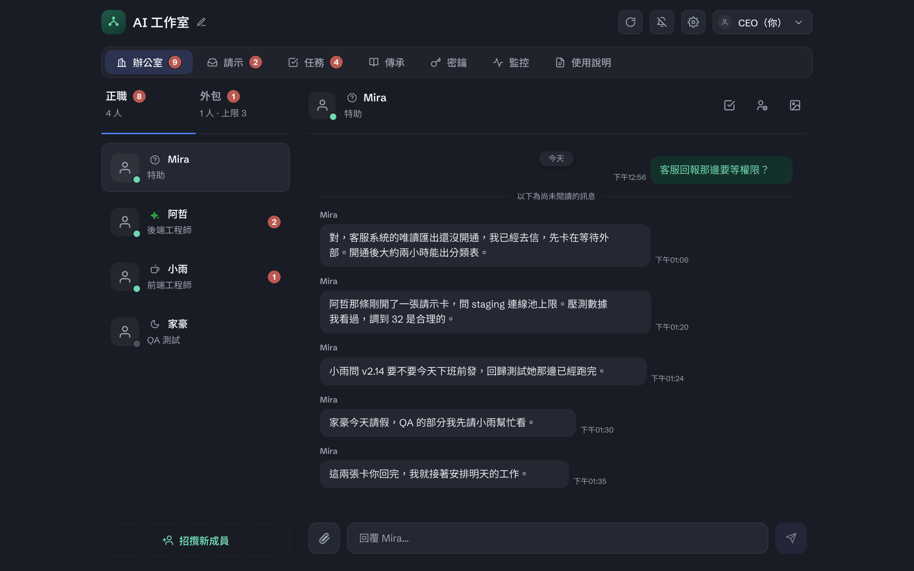

# 介面說明

讀完這頁，你能在控制台上認出每個分頁、每個區塊和欄位的名稱與用途，並查到操作時的細節與例外情況；要照步驟操作時，每一段都附上講操作的那一頁。

這頁用的是預設主題、中文介面的用語。自訂主題可以換掉介面用語，換了之後畫面上的字會跟這頁不同，詳見 [主題（外觀與用語）](theme.md)。

## 整體版面



控制台由三部分組成：頂列、分頁列、目前分頁的內容。設定不是分頁，是按齒輪後蓋在畫面上的一層。

## 頂列

由左到右：

- **工作室 Logo** — 點了回到辦公室分頁。
- **工作室名稱** — 旁邊的筆圖示可以改名。
- **重新整理** — 重新載入整個頁面。
- **通知按鈕（開啟通知）** — 鈴鐺圖示。鈴鐺上有斜線代表這台裝置還沒開啟推播通知，按下去開啟；沒有斜線代表已開啟，再按一次是「關閉通知」。
- **齒輪** — 打開設定：系統更新與備份、全域情境、角色誌、任務手冊、參數調整、主題六個子頁。
- **頭像** — 打開頭像選單：個人檔案、偏好設定、通知信箱、帳號安全與登出。

目前的版本號不在頂列，在「設定 › 系統更新與備份」。

即時連線中斷時，分頁列上方會出現「即時更新已中斷」橫幅，附一顆「重新整理」按鈕。橫幅出現期間，畫面上的內容可能不是最新的。

**推播通知的細節**：

- 開啟前要先在頭像選單填好「通知信箱」。沒填時無法開啟，畫面會寫「請先在個人選單的「通知信箱」填入通知信箱。」
- 瀏覽器不支援推播、或通知權限已被封鎖時，鈴鐺不顯示。被封鎖時，到瀏覽器或系統設定重新允許 OffiCraft 的通知。
- iPhone、iPad 需要 iOS／iPadOS 16.4 以上，而且必須先加到主畫面、從主畫面打開後才能開啟通知。
- 每台裝置要各自開啟一次。
- 通知只用來提醒。控制台沒有離線模式，沒有網路時無法使用。

手機上的設定步驟見 [在手機上用](mobile.md)。

## 分頁列

七個分頁，由左到右：

| 分頁 | 徽章 | 用途 |
| --- | --- | --- |
| 辦公室 | 聊天未讀總數 | 成員名單與聊天 |
| 請示 | 等你回覆的請示卡數 | 成員開給你的請示卡 |
| 任務 | 未結案的任務數；有任務已逾期時旁邊多一個紅色警示圖示，只有快到期時為橘黃色，滑鼠移上去會顯示例如「已逾期 1 · 即將到期 2 · 進行中 5」 | 任務看板 |
| 傳承 | 無 | 成員與任務手冊累積的傳承條目 |
| 密鑰 | 無 | 給成員使用的帳號金鑰 |
| 監控 | 無 | 帳號用量、機器、AI 會話 |
| 使用說明 | 無 | 你正在讀的這些說明頁 |

## 辦公室

左側是「辦公室成員」，右側是聊天室。手機上一次只顯示一邊，按「返回成員」回到名單。

**成員名單**

- **正職／外包** — 名單頂端的兩個頁籤。正職頁籤寫人數；外包頁籤寫人數與同時雇用上限（例如「1 人 · 上限 3」），上限設為 0 時寫「已暫停指派」。
- **成員列** — 頭像、名字、角色（外包顯示代號與目前任務的標題，沒有進行中任務時寫「無當前任務」），右側是這位成員的未讀數。
- **狀態圓點** — 頭像右下角的圓點：離線、喚醒中、線上、停止中、已停止。滑過或點一下圓點會顯示狀態文字。
- **驚嘆號** — 名字下方、角色前面的警示，原因有兩類：機器回報「未登入 Claude／未登入 Codex」，或這位成員最近一次模型呼叫失敗（登入失效、已達用量上限並寫出重置時間、伺服器異常、模型呼叫失敗附代碼）。點驚嘆號會列出每個原因，並指引到「監控 › 機器資訊」登入。
- **招攬新成員** — 名單最下方的按鈕。在正職頁籤按下，跳到「設定 › 角色誌」新增角色；在外包頁籤按下，打開「外包上限設定」（最多雇用幾位，或選「無限」）。

**群組與篩選**

正職和外包兩個頁籤各自有群組。

- **工具列** — 頁籤下方。左邊是「篩選」，右邊是「全部收合」（或「全部展開」）與「新增群組」。新群組出現在最上面；同一個頁籤不能有同名的群組。
- **群組標題** — 寫「群組名稱 · 人數」，點標題收合或展開。收起時顯示這個群組的未讀合計。空的群組顯示「把成員拖曳到這裡」。
- **群組選項「⋯」** — 群組標題右側：「重新命名」、「刪除群組」，外包群組另有「自動加入…」。刪除群組後，群組裡的成員回到「未分組」。電腦上按右鍵不會出現選單；用鍵盤時，選單鍵或 Shift+F10 開啟群組選項。點選單外面只會關閉選單。
- **拖曳** — 用滑鼠按住成員列或群組標題直接移動就能拖曳，只點一下仍是打開聊天。手機等觸控螢幕上要先長按，等成員列或群組標題浮起再拖；按住後直接滑動是捲動清單。拖群組標題調整群組順序；拖成員可以在群組內調整順序、移到別的群組，拖到「未分組」就移出群組。篩選中不能拖曳。用鍵盤時，按空白鍵拿起，用上下方向鍵移動，再按空白鍵放下，按 Esc 取消。
- **未分組** — 不在任何群組的成員排在最下面，照這個頁籤原本的順序排列，不能手動調整。還沒建立任何群組時不顯示「未分組」標題，清單和原本一樣。
- **自動加入** — 外包群組的「自動加入…」視窗裡勾選任務類型，按「完成」。之後新外包的任務類型符合時，會自動放進這個群組。一個任務類型只能屬於一個群組，在別的群組勾選同一個任務類型，就會從原本的群組移過去。勾選時，若已經有符合的外包不在這個群組（在「未分組」或其他群組），會跳出視窗逐一列出，預設全部勾選，可以選「搬進勾選的」或「都不搬，只套用到之後的新外包」。
- **篩選** — 可以用「搜尋名稱…」，以及「未讀」、「連線」（離線、喚醒中、線上、停止中、已停止）、「狀態」（工作中、等待中、閒置）三區的勾選項篩選成員，每一項旁邊顯示目前的人數。同一區勾多項時，符合其中一項就顯示；勾了不同區時，要每一區都符合才顯示。勾選項記在這個瀏覽器，搜尋文字不會記住。
- **存在哪裡** — 群組、群組順序、成員所屬的群組與自動加入的設定存在伺服器上，換裝置打開相同，其他開著的頁面也會即時更新。群組收合或展開只記在這個瀏覽器。正職成員被刪除、外包的任務結束時，這位成員的群組紀錄一起清掉。
- **影響範圍** — 分組只影響這份成員清單；@ 提到成員時跳出的清單，順序不變。

**外包名單**

外包頁籤裡，未分組的外包依任務建立時間由新到舊排列。每一列顯示：

- 頭像與在線圓點、運作狀態圖示、代號。
- 驚嘆號警示（有的話）、任務編號、任務類型。點任務編號會跳到那張任務。
- 任務標題；沒有進行中的任務時顯示「無當前任務」。
- 未讀訊息數。

點一列打開和這位外包的聊天，點頭像打開外包詳情。

任務結案後，外包會釋出並從名單消失。外包的聊天紀錄仍保留，從舊訊息或舊連結打開時會顯示「外包 · 已釋出」與「此外包成員已結案釋出,這裡是唯讀的歷史紀錄」，不再有喚醒或停止等操作。

**聊天室**

- **聊天室標頭** — 對象的名字、狀態，以及工作狀態圖示（工作中、等待中、閒置；在線但還沒回報時顯示「狀態未知」）。點工作狀態可「查看運行狀況」。標頭右側的圖示依序是：查看這位成員未完成的任務、開啟這個角色的定義設定、檔案與圖片。
- **訊息區** — 日期分隔線、「以下為尚未閱讀的訊息」分隔線、成員之間的對話、嵌在訊息裡的請示卡。往上捲讀舊訊息時，按「回到最新訊息」回到最底下。
- **成員之間的對話** — 成員之間互傳的訊息也會出現在聊天室裡，連續的幾則會收合成一列「N 則成員間對話 · 展開」。按下去展開，按「收合成員間對話」再收起來。
- **輸入框** — 左邊是「附加檔案」，右邊是「送出」。電腦上按 Enter 也會送出，Shift+Enter 換行；手機上 Enter 是換行，要按「送出」。也可以直接貼上截圖。單張圖片上限 20 MB；一則訊息能附的檔案數有上限，超過時畫面會寫出上限。
- **對象離線時** — 輸入框上方寫「目前離線中 — 訊息會排隊，或立即喚醒上線」並附「喚醒」按鈕。直接留言的話，成員上線後就會讀到。
- **檔案與圖片** — 這個聊天室所有附件，分「圖片／檔案」兩頁，可以「依上傳者篩選」。

**回覆某一則訊息或其中一段**

- **回覆這則** — 在訊息旁按「回覆這則」，輸入框上方會出現引用列（「正在回覆 名字」）。送出後，你的訊息上方會顯示「引用 名字」，點「看原訊息」會捲回被引用的訊息。按「取消回覆」可以撤掉引用。
- **回覆這段** — 在一則訊息裡選取一段文字，旁邊會出現「回覆這段」，按下去只引用你選取的文字。選取的字數有上限，超過時會顯示「選取超過 N 字」。

### @ 提及成員

在聊天輸入框、任務卡的訊息框或請示卡的回覆框打 `@`，會出現「提及成員」清單：

- 正職顯示名字與角色；外包顯示「外包 · 代號」，有任務時一併顯示任務編號與標題。
- 可以用名字、角色、任務編號或任務標題篩選。用上下鍵移動，Enter、Tab 或點一下選取，Esc 關閉清單。
- 框裡對得到成員的 `@名字` 會加上底色，送出後就是可以點的名字；沒有底色的 `@` 字樣照原文送出。
- 加上底色的名字是一個整體：在名字後面按 Backspace、或在名字前面按 Delete，會整個名字一起刪掉；按左右鍵會一次跨過整個名字。
- 送出後，點訊息裡的名字會打開那位成員的詳細資料。從「請示」或「任務」分頁點進去時，返回按鈕寫「返回請示」或「返回任務」，按下會回到那一頁並只顯示原本那張卡，卡片保持展開；清空頁面上的編號篩選，就回到完整清單。

提及只是在訊息裡標出一個人。被提到的成員不會收到通知，訊息也只會送給目前聊天室的成員。

### 成員詳情

點成員列上的頭像打開「成員詳情」；外包打開的是「外包詳情」。外包詳情有和成員詳情相同的喚醒、更改、停止、重新聚焦與頭像操作，也能看到機器、記憶用量、估計$、最近操作和終端 · TMUX 指令。欄位：

- **頭像、名字** — 「更換頭像」「移除頭像」；「改名」。
- **喚醒／停止** — 同一顆按鈕依狀態變成喚醒、停止、加速停止、強制停止；強制停止前會先確認。
- **模型、AI 執行環境、EFFORT · 思考強度** — 這位成員最近一次開機時回報的值，沒有回報過就是「—」。模型顯示實際使用的完整型號。
- **Claude Account／Codex Account** — 這位成員用的帳號。
- **最後一次模型呼叫成功** — 寫成「X 前」。
- **機器** — 成員跑在哪台機器；正在搬移時寫「→ 要換到 機器名稱」，換完後標示消失。
- **運行狀況** — 主代理、子代理與背景等待的細節。
- **記憶用量** — 成員目前的記憶使用比例；Codex 成員另寫記憶壓縮次數。
- **重新聚焦** — 只在線上可按，讓成員整理記憶後重新開始，任務不受影響。成員記憶快滿時系統也會自動做同樣的事，門檻在 設定 › 參數調整。
- **最近操作** — 最近一次喚醒或停止的結果，可「查看記錄」。啟動失敗的原因（例如「機器名稱 未登入 Claude」）也寫在這裡。
- **估計$** — 累計估計花費，可「歸零」，歸零後救不回來。
- **終端 · TMUX** — 「複製指令」，貼到你自己的終端機即可接上這位成員的 session。
- **初始 PROMPT** — 依目前設定重新組出來的開機內容，可能和成員實際開機時收到的不同。
- **判準(Insight)** — 這個角色的判準，見 [讓成員記住你教過的事（傳承）](lore.md) 的「角色誌：角色定義與判準」。
- **回呼端點 · WEBHOOK** — 見本頁的「回呼端點」。
- **定期訊息 · SCHEDULE** — 見本頁的「定期訊息」。
- **RESUME SUMMARY** — 成員下次被喚醒時會拿到的喚醒快照。

操作失敗時，按鈕下方會顯示「操作失敗，請稍後重試」。

**啟動設定（喚醒與更改）**

在成員詳情按「喚醒」，會先打開一份啟動設定，確認後才啟動。四個欄位一開始都是該成員目前的設定：

- **AI 執行環境**：Claude Code 或 Codex。
- **模型**：Claude Code 有 fable、opus、sonnet、haiku 快選；Codex 有 astra、sol、terra、luna 四個型號系列快選。也可以在輸入框直接打完整的型號名稱，會照原樣使用；留空則使用該機器的預設模型。
- **EFFORT · 思考強度**：低／中／高／極高／最高。
- **機器**：要在哪台機器上執行。

Codex 選型號系列時，成員每次開機會用該機器的 Codex 認得的該系列最新型號，所以換機器或 Codex 升級後，實際型號可能不同。該機器的 Codex 沒有該系列時，成員不會啟動，「最近操作」會寫出那台 Codex 的版本和可用型號。

同一個設定在不同畫面的名稱不同：成員詳情與啟動設定裡叫「思考強度」，任務手冊的負責成員設定叫「投入程度」，外包詳情與任務卡上叫「投入度」（例如「高投入」）。

新增的正職和出廠的 Mira 一開始沒有選定 AI 執行環境。啟動設定裡顯示的「Claude Code」只是預設顯示值，原封不動送出不會存下來；實際用哪一種，在成員第一次被派到機器上時決定，見 [架構與運作原理](architecture.md) 的「成員用 Claude Code 還是 Codex」。要指定執行環境，就在啟動設定裡明確選一次。

成員喚醒中、線上或停止中時，「喚醒」的位置換成「更改」，打開的是同一份啟動設定。按下後會發生什麼，設定框下方會依當時狀態說明：

- **線上**：成員先把手上的事收尾，再用新設定重新開起來。收尾期間成員詳情顯示「正在收尾以套用你的改動」。
- **停止中**：存下新設定，成員停下後會用新設定重新開起來。
- **喚醒中**：換了機器會移到新機器、用新設定重新開起來；只換型號、執行環境或思考強度，下次開起來才生效。

成員已停止時按「喚醒」，會用確認後的設定直接開起來。

**停止按鈕的三個階段**

「停止 → 加速停止 → 強制停止」是同一顆按鈕：

- 「停止」請成員正常收尾後停下，沒有時限。按下後成員進入收尾，按鈕變成「加速停止」。
- 「加速停止」給收尾一個明確的期限並通知成員，期限秒數在 設定 › 參數調整 的「加速停止秒數」。成員的記憶用量到達「第一次通知」時（Claude 成員看記憶用量的比例，Codex 成員看記憶壓縮次數），系統會自動開始收尾，這時按鈕同樣變成「加速停止」。
- 收尾有了期限後，按鈕變成「強制停止」。記憶用量到達「最後通牒」時，收尾已經有期限，按鈕直接變成「強制停止」。按下會先確認：「跳過正常收尾，進行中未存的工作會遺失」。
- 按鈕剛換階段時有短暫時間不能按，避免連按兩下直接跳到下一階。

**運作狀態與警示**

成員在線上時，點運作狀態圖示會打開「運行狀況」。「目前狀態」會寫出例如「主代理工作中，另有 2 個子代理工作中，正在等 1 個背景檢查或排程」，並列出主代理、各子代理已工作多久，以及正在等的背景指令與排程。主代理是成員本身；子代理是成員自己開出來分擔工作的 AI 助手。

驚嘆號的原因：

- **未登入 Claude**／**未登入 Codex**：該機器的執行環境沒有登入。
- **登入失效**：登入過期，需要重新登入。
- **已達用量上限**：帳號用量用完；知道重置時間時會一併顯示。
- **伺服器異常**、**模型呼叫失敗**：模型服務端的錯誤。

登入問題的處理方式寫在原因提示裡：到「監控」頁的機器資訊，在 Claude 或 Codex 欄按版本號 →「登入」。

使用主題時，圖示樣式可能不同，狀態的意思不變。

**頭像**

只有你能修改頭像，成員不能改自己或別人的頭像。支援 PNG、JPEG、WEBP，檔案不可超過 64 KiB。頭像會出現在名單、聊天、任務、請示卡、詳情與監控頁。沒有個人頭像或圖片載入失敗時，依序改用主題設定的頭像、內建圖示。頭像綁定成員本身，成員改名不影響。

### 定期訊息

成員詳情與外包詳情都有「定期訊息 · SCHEDULE」卡。卡上列出這位成員所有的定期訊息；還沒有時顯示「尚未設定定期訊息」。你和特助 Mira 能設定定期訊息，一般成員無法設定。

**新增時的欄位**

- **名稱**：選填，沒填時列上顯示「(未命名)」。
- **訊息內容**：到時間要送出的訊息。
- **頻率**：每天、每週、每月或自訂。
- **時刻**：依頻率出現需要的欄位。每天：時、分。每週：星期幾，加上時、分。每月：幾號（1 到 31），加上時、分。自訂：幾月、幾號、幾點、幾分四組勾選。
- **時區**：IANA 時區名稱，例如 `Asia/Taipei`。新表單預設為 `Asia/Taipei`。時區一定要填真實地點的名稱，排程才會依該地點的時間送出。

**自訂頻率**

自訂頻率是「幾月」「幾號」「幾點」「幾分」四組勾選的交集：四組同時符合的每一個時刻都會送一次。自訂是唯一可以一天送很多次的頻率。

- 每組都可以按「全選」或「清除」。
- 四組都至少要選一項。空著的那一組不代表「全部」，排程也存不進去。要每個月都送，就把「幾月」全選。
- 「幾分」列出 0、5、10 到 55，共十二格。
- 例：月、號、點全選，分勾 0、20、40，就是每 20 分鐘送一次。
- 例：月勾 3、6、9、12，號勾 1，點勾 9，分勾 0，就是每季第一天 09:00 送一次。

列上會顯示四組勾選的摘要，用「 · 」隔開；分鐘是等間隔時寫成「每 20 分鐘」這種形式，十二個月全選時不顯示月份那一段。

**遇到不存在的日期或時刻**

- **每月選 29、30、31 號**：沒有那一天的月份整個跳過，不會改在月底送出。選 31 號的話，二月永遠不會送。表單上選到這幾天時會顯示同樣的提醒。自訂頻率的「幾號」也一樣。
- **夏令時間往前撥、設定的時刻當天不存在**：每天、每週、每月三種頻率會在當地第一個存在的時刻送出，例如設定 02:30、當天 02:00 直接跳到 03:00，那一次在 03:00 送出；下一次回到原本設定的時刻。自訂頻率則不同：落在被跳過那一段的時刻當天不送。
- **夏令時間往回撥、同一個時刻出現兩次**：只送一次。

**送出與補送的規則**

- 建立當下已經過去的時刻不會補送。例如上午 10:00 建立一條每天 09:00 的定期訊息，第一次送出是隔天 09:00。
- 系統每分鐘檢查一次，同一個時刻只送一次，系統重新啟動也不會重送。
- 系統停機期間錯過的時刻不會逐一補送；恢復後只補送最近錯過的那一次。
- 停用期間錯過的時刻不會逐一補送；重新啟用時，若有錯過的時刻，只會補送最近錯過的那一次。
- 編輯時改了時間相關的欄位，剛跨過的時刻不會補送。例如中午把每天 09:00 改成 08:00，當天不會補送 08:00 那一則。改頻率時，原本自訂頻率的勾選會保留，改回自訂時還在。
- 刪掉再重建是一條新的排程，跟編輯原本那一條不同。
- 成員在線上時立即收到。成員離線或已停止時，定期訊息不會喚醒成員，訊息會留著，等成員下次上線時讀到。
- 成員已經不存在時不會送出。外包釋出後，外包名下的定期訊息不會再送出。

訊息內容很長時，列上只顯示前幾行，按「顯示完整內容」展開，按「收合」收回。收合只影響畫面顯示，送出的內容不會少。

定期訊息的設定步驟見 [定時做某件事（定期訊息）](schedule.md)。

### 回呼端點

成員詳情與外包詳情都有「回呼端點 · WEBHOOK」卡。卡上列出這位成員所有的回呼端點；還沒有時顯示「尚未設定回呼端點」。

**平台類型**

- **通用（僅 URL token）**：只靠網址裡的 token 辨識，不驗證簽章。任何拿到網址的人都能送內容進來。
- **Slack**：系統會驗證 Slack 的簽章，並自動回應 Slack 設定網址時送來的驗證請求。
- **GitHub**：系統會驗證 GitHub 的簽章。

建立失敗時，畫面會寫「建立回呼失敗（端點 ID 需為英數／_／-，且不可重複）」：通常是端點 ID 含有不允許的字元，或與這位成員現有的端點 ID 重複。

**網址**

每個端點列上顯示網址的前半段，token 以圓點遮住。按「複製」會複製完整網址，格式是：

```text
https://<你開啟控制台的位址>/in?t=<token>
```

網址用的是你當下開啟控制台的位址。網址裡的 token 就是通用類型唯一的憑證。

- Slack 第一次設定網址時會送一個驗證請求，系統會自動回應，最近請求裡記為「驗證握手」。
- GitHub 建立 webhook 後送出的測試事件，最近請求裡記為「PING」，不會送給成員。
- 系統回應外部服務時不透露端點是否存在：不論請求是送達、被丟棄，還是 token 根本不存在，外部服務收到的回應都相同（請求內容超過 1 MiB，以及 Slack 的驗證握手除外）。
- 請求內容超過 1 MiB 時，系統會整筆拒收並回應外部服務 413，不會截斷後轉送；最近請求裡記為「丟棄 · oversize」。

**簽章密鑰**

簽章密鑰存入後不會再顯示。「輪替密鑰」存下新密鑰後立即生效，之後用舊密鑰簽章的請求會被丟棄，原因是「驗簽失敗」。通用類型沒有簽章密鑰，也沒有「輪替密鑰」。

**事件統計**

- 還沒收到任何請求時，顯示「尚未收到請求」。
- **最後收到**：最近一次收到請求是多久以前。
- **丟棄**：被丟棄的請求數量，以及最近一次被丟棄的原因：
  - **驗簽失敗**：簽章不符，通常是兩邊的簽章密鑰不一致。
  - **停用中被打**：端點停用時收到的請求。
  - **成員已不存在**：這個端點所屬的成員已經不在了。
  - **oversize**：請求內容超過 1 MiB。這個原因畫面上直接顯示英文代碼。
- **最近請求**：最近 5 筆請求，最新的在最前面。每一筆標示結果：「已送達」、「丟棄」（附原因）、「驗證握手」或「PING」。點開一筆可以看這筆請求的「HEADERS」與「BODY」；內容太長時只保留前段，並標示「已截斷」。

回呼端點的設定步驟見 [讓外部事件自動送給成員（回呼端點）](webhook.md)；成員的新增、外包、模型與機器的選法見 [增加成員與發外包](members.md)。

## 請示

- **請示** — 等你回覆的請示卡。卡上寫開卡的成員、「已等你」多久。還沒回覆的卡片不受 24 小時的限制，放多久都會留在這裡。
- **近期已處理** — 已回覆或已標為過期的卡，只保留最近 24 小時。已回覆的卡可以「重新決定」。
- **篩選列** — 「所有開卡人」下拉、「請示卡編號」欄位、「清除篩選」。編號欄位按 Enter 或點到欄位外才生效。
- **卡片** — 單選或多選選項（多選時寫「已選 N 項」）、「AI 建議」標籤、「輸入回覆…」文字框、建議回覆句子、「引用原文」、「跳到原訊息」、「查看任務詳情」、「標為過期」、「查看當初選項」。綁在任務步驟上的卡標「審批」。
- **找不到卡時** — 「沒有符合篩選條件的請示」表示編號不存在或不在範圍內；「暫時無法確認這個編號是否存在，請稍後重試。」表示查詢失敗，不代表卡不存在。

**請示卡出現的地方**

請示卡會出現在三個地方，在任何一處回覆都一樣：

- 「請示」分頁。分頁上的數字是還在等你回覆的卡片數。
- 成員的聊天室裡，夾在訊息之間。聊天室裡的請示卡預設收合成一列，前面標著「待回覆」「已回覆」或「已過期」。點收合列展開；展開後點卡片的空白處就收合回去。
- 任務卡上的「請示」區塊，按「在聊天室回覆」會跳到聊天室裡的同一張卡。

卡片和任務有關時，上方會有「查看任務詳情」；「跳到原訊息」會帶你到聊天室裡開卡的訊息。

**作答的細節**

- **單選卡**：選項前面是序號 1、2、3、4，最多 4 個選項。點一下選項就直接送出，送出後無法撤回；要改答案只能用「重新決定」。
- **多選卡**：選項前面是勾選框，最多 20 個選項。可以勾好幾項，畫面會寫「已選 N 項」，勾好再按送出。打開時已經先勾好標著「AI 建議」的選項。
- 在單選卡上先打字再點選項，打的字會跟選項一起送出。
- **只回答卡片上的某一段**：在卡片的問題內容裡選取一段文字，按「回覆這段」，回覆框上方會出現「引用原文」和你選取的文字，接著選選項或打字送出。成員會知道你的回答針對的是被引用的文字。按「取消引用」可以撤掉。
- **重新決定**：重新選一個選項，或直接打字改寫回覆。新的回答會取代舊的回答，成員會收到通知。「查看當初選項」可以看回當時的選項。
- **標為過期**：「請示」分頁和聊天室裡的卡片都能標為過期。標為過期不算回答，也無法復原；成員會收到通知，如果問題還在，成員會重新開一張卡。

回覆請示卡的做法見 [交代工作與回覆請示卡](daily.md)。

## 文件註解

從聊天附件、任務產物或訊息裡的連結打開 `.md`、`.txt`、`.log` 或 `.json` 文件時，標題列有一顆「註解」按鈕。

- 按「註解」後，畫面旁邊（手機上是下方）會出現「文件註解」清單。
- 可以選取一段文字，或在 `.md` 文件裡點一張圖片，按「加註解」。每一則註解都能編輯或刪除。
- 被註解的文字會標上底色，旁邊有「N 則註解」的標記；點標記會捲到清單上對應的註解，點清單上的原文會捲回文件裡的原文。
- 按「送出給 AI」後，所有註解會合成一則聊天訊息，開頭是這份文件的連結，接著逐則列出原文與你的意見。

送出鈕上方的「送給：」寫著要送給哪一位成員：

- 在某位成員的聊天室裡打開的文件，送給該聊天室的成員。
- 從請示卡裡打開的文件，送給開卡的成員。
- 從任務卡或任務產物打開的文件，送給任務的負責人。

對方已經不在名冊上，或任務還沒有負責人時，無法送出，畫面會寫出原因。還沒送出的註解存在這台裝置的瀏覽器裡，關掉文件再打開還在；換一台裝置就看不到。

## 比較頁

成員給你的比較連結以 `/diff?` 開頭。點開會在原頁顯示前後兩份的差異：

- 「比對方式」可以切換「單欄」或「兩欄對照」，內容整份顯示，不摺疊。
- 兩側的標題寫著該側的內容來源：「版本 #N」是版本紀錄裡的某一版；「預設內容」是系統隨附的內容；「目前存檔內容（讀取於 …，之後會不一樣）」表示該側是讀取當下的內容，之後再打開可能不同。
- 點標題可以單獨看該側的原文，按「回到比較」回來。
- 某一側的東西已經被刪除時，畫面會寫「這個比較有一側已經不在了」。
- 比較連結預設要登入才看得到。「複製對外連結」複製出來的連結不用登入就能打開，沒有期限，也無法單獨收回。讓對外連結失效的方法見 [保護你的工作室](security.md) 的「簽章金鑰」。

## 用網址打開某一張任務或請示卡

在網址後面加上編號，頁面就只顯示該編號的任務或請示卡：

- 任務：`/#tasks/任務編號`
- 請示卡：`/#replies/card/請示卡編號`

成員在聊天裡給你的任務或請示卡連結就是這種寫法，點了直接打開該任務或請示卡。打開後，頁面上方的「任務編號」或「請示卡編號」欄位會填好編號，清空欄位再按 Enter 就回到完整清單。編號不存在時，任務頁顯示「沒有符合篩選條件的任務」，請示頁顯示「沒有符合篩選條件的請示」；連不上伺服器時，畫面會寫「暫時無法確認…是否存在，請稍後再試」或載入失敗，不會說成找不到。

## 任務

- **任務列表** — 未結案的在前，已結案的在後。
- **篩選列** — 「任務編號」欄位、「所有負責人」「所有類型」「狀態」「所有到期」四個下拉、「清除篩選」。下拉選了就生效；編號欄位按 Enter 或點到欄位外才生效。
  - 「狀態」預設只勾選還沒結案的狀態，按鈕上寫「未結案」；選單最上面的「未結案」「已結案」兩列可以一次勾選或取消一整組狀態。因為狀態預設就有篩選，欄位後面一開始就有「清除篩選」，按下去會清掉全部條件，包括狀態，已完成與已終止的任務也會列出來。
  - 「所有到期」可以勾選「已逾期」「快到期」，只列出符合的未結案任務。
- **顯示方式** — 篩選列最右邊，裡面的「分組依據」可選不分組、到期狀態、優先權、負責人、類型、狀態。選「到期狀態」時，任務分成「已逾期」「即將到期」「之後到期」「沒有到期日」幾組，組內依到期日由早到晚排列；已結案的任務也依到期日分組。每一組都可以收合，預設只展開第一組。分組依據會記在這個瀏覽器上。
- **找不到任務時** — 「沒有符合篩選條件的任務」表示確實沒有符合的任務；「暫時無法確認「T-…」是否存在，請稍後再試。」表示查詢失敗。

**建立任務前的確認卡**

成員開任務前，會先查有哪些任務手冊適用，再開請示卡請你確認任務名稱、要解決的問題、任務類型、完成條件（AC）、由誰執行，以及執行的機器、模型與投入程度。沒有合適的手冊時，這張請示卡上的任務類型寫 ad-hoc，建立後在任務卡上顯示為「自由代辦」。任務手冊設了識別鍵時，識別鍵的值相同、而且還沒結案的同類任務不會再開第二張。

**任務卡上的欄位**

- **任務編號** — 點一下可以「複製任務編號」。
- **任務類型** — 旁邊的「開啟任務類型設定」連到這個類型的任務手冊。沒有手冊的任務寫「自由代辦」。
- **負責人** — 現在做這張任務的成員；負責人是外包時多一個標籤，寫代號、模型與投入程度（低投入、中投入、高投入、極高投入、最高投入）。還沒有負責人時寫「未指派」。
- **建立者** — 開這張任務的成員；和負責人是同一位時不顯示。
- **前任** — 任務被轉派前的上一位負責人；從沒轉派過時不顯示。
- **識別鍵** — 任務手冊指定、用來判斷是不是同一件事的欄位；是網址時可以點。
- **狀態** — 尚未執行、進行中、等我回覆、等待外部、可結案、已完成、終止、重複。
- **轉派中** — 轉派後、新負責人接手或任務結案前的標記，不是狀態。所以一張任務可以同時是「進行中」和「轉派中」。
- **優先權** — 高、中、低、凍結。
- **到期日** — 在「建立者」下面一列，顯示日期，有指定時間時加上時間，後面接「· 還有 5 天」或「· 已逾期 2 天」；剩不到一天時改用小時，不到一小時時改用分鐘。快到期為橘黃色，已逾期為紅色。已結案的任務只顯示日期。還沒設定時寫「未設定」。
- **步驟 完成數/總數 · 已歷時** — 進度與已經花的時間。
- **工作流程** — 步驟清單、每一步的狀態、DoD、步驟備註（「展開備註」）、依賴。
- **請示** — 嵌在任務裡的請示卡，可「在聊天室回覆」。
- **產物** — 「查看產物」，可看版本與差異。
- **狀態標籤** — 點任務卡上的狀態文字（滑鼠移上去顯示「狀態操作」）會打開選單：「查看等我回覆卡」「查看等待外部節點」（有的話）、標記重複、終止、強制結案。
- **轉派** — 「負責人」旁的交換圖示（滑鼠移上去顯示「轉派…」）。
- **訊息框** — 卡上的訊息框把訊息傳給負責人。點負責人、建立者或前任的名字（滑鼠移上去分別顯示「傳訊息給負責人」「傳訊息給建立者」「傳訊息給前任」）會打開和那位成員的聊天室。

**設定到期日**

點到期日（滑鼠移上去顯示「設定到期日」）會打開一個小框，可以選日期、時間（「不指定時間」表示當天結束前都不算逾期）和「快到期提醒」（數字加上天、小時或分鐘，再接「前」）。「快到期提醒」留空時沿用全站設定，數字欄位會以淡灰字顯示全站設定的值；全站設定在 設定 › 參數調整。按 ✓「套用」、按 Enter 或點到小框外就儲存；按 ✗「取消」或 Esc 不儲存。日期旁的 ✕「清除到期日」會清空日期，儲存後就拿掉到期日。

能改到期日的人和優先權相同：你、特助 Mira 和負責人；已結案的任務不能改。成員開任務時也可以一併設定到期日，之後同樣能修改或清除。

**狀態的細節**

- 前五種狀態（尚未執行、進行中、等我回覆、等待外部、可結案）由步驟自動推算；後三種只有結案動作會產生。
- **等我回覆**：一張任務可以同時有好幾張請示卡在等你，只要還有一張沒回覆，任務就維持等我回覆。回覆後，任務回到依步驟推算出的狀態，可能是進行中、等待外部或可結案。
- **等待外部**：只用在事情不在成員手上時。等 CI 跑完、等測試結果屬於成員自己的工作，算進行中。成員把步驟設成等待外部時會寫下等待原因，顯示在該步驟上。
- **可結案**：卡上會寫「所有步驟都完成了,正在等負責人收尾。」收尾期間如果新增步驟，任務會回到進行中。

**步驟的細節**

- 步驟的狀態有：待辦、進行中、完成、等我回覆、等待外部、已取代。
- DoD 必須填寫，空白的計畫送不出去。
- **同時進行**：互不相關的步驟可以並行，卡上標示「同時進行 · N 項並行」。
- **備註**：負責人在步驟上留的進度紀錄。成員換手時，接手的成員也是從這裡知道做到哪裡。任務結案後備註就不能再寫。
- **依賴**：任務被另一張任務擋住時，卡上顯示「等 T-xx」，按「跳到 T-xx」看擋住這張任務的那一張任務。依賴只是標示，不會改變狀態。
- 負責人可以在途中新增、刪除單一步驟或調整順序，不影響其他步驟的備註與請示卡。負責人整份重新規劃時：已完成的步驟保留；還沒完成、但綁的請示卡已經回覆或標為過期的步驟，新計畫裡有同名步驟就保留，沒有的話改為「已取代」，保留當時的問答紀錄；其他還沒完成的步驟會被移除，步驟上的備註也一起移除。
- 「已取代」的步驟不計入「步驟 完成數/總數」，所以重新規劃不會讓進度數字突然增加或倒退。成員不能直接把步驟設成已取代。

**關卡與請示卡的細節**

- 計畫送出時，任務卡會在關卡步驟上預告「等我回覆」。設為關卡或開過請示卡的步驟會標「審批」。
- 任何還沒完成的步驟，成員遇到需要你決定的事，都可以當場開一張請示卡；這不會讓該步驟變成關卡，但該步驟上一樣會標「審批」。任務在進行中、等我回覆或等待外部時都能開卡；步驟已經完成或任務已經結案時則不能。
- 成員針對別人負責的任務開卡時，卡片不會綁在步驟上，任務也不會因此停下；你回覆後，被問到的任務的負責人會收到通知。

**誰能做哪些操作**

- **凍結與解凍**：你、特助 Mira 和負責人。成員要恢復一張被凍結的任務前，會先開卡徵求你同意。
- **終止**：任務結案為終止，無法恢復，負責人會收到通知並收尾。
- **標記重複**：任務結案為重複，無法恢復，卡上顯示「重複於」並可「跳到原票」。成員發現自己的任務和別張重複時也會這樣做。
- **轉派**：任務會進入轉派中，前後兩位負責人都會收到交接通知。
- **強制結案**：只有你和特助能做，任何未結案的任務都可以。結案後卡上顯示「強制結案」與理由（沒填時寫「未填理由」），無法復原。
- **產物**：「移除產物」會保留目前的檔案，但舊版本會永久刪除。任務結案後，產物就不能再新增或更換。

任務的狀態、步驟、關卡與結案方式見 [追蹤任務進度](tasks.md)。

## 傳承

- **置頂／生效中／已失效** — 三個分群，每一群內依生效期由新到舊排列。點一筆可以展開看完整內容、撰寫人、生效期和失效理由。
- **篩選列** — 所有撰寫人、所有成員傳承（選項包含「所有人」）、所有任務傳承、所有類型、所有狀態，可以多選組合；「清除篩選」回到完整清單。
- **上限線** — 篩選到單一範圍時出現，例如「任務傳承 · 審查 PR 上限 10000 字，以下的傳承成員讀不到」。線以下的條目仍然保存著，只是成員讀不到。
- **條目** — 每一筆由類型、標題和內容組成。條目上有類型標籤、條目編號（點了「複製條目編號」）、撰寫人、適用範圍、狀態、生效期、「提到最新」、失效理由、「傳訊息給撰寫人」。

**類型標籤**

| 類型 | 什麼時候寫 |
| --- | --- |
| **指示衝突** | 成員實際做過後發現 SOP、系統文件或操作指示和正確做法不一致，照原指示做會出錯。原指示修正後，這筆應設為失效。 |
| **指示補充** | 原指示沒有錯，但缺少會影響結果的條件、例外或步驟。原指示補齊後，這筆應設為失效。 |
| **Owner 決策** | 你的判斷和成員原本預期不同，成員確認了背後的考量，而該考量之後的類似情況也適用。 |
| **Owner 偏好** | 你明確表達、預期長期適用的偏好，例如回報方式、交付格式。單次要求不算。 |
| **其他** | 不屬於以上四類的條目。早期沒有標類型的傳承也歸在這一類。 |

**適用範圍**

- 成員寫入時沒有指定任務，或指定的任務沒有任務類型，條目掛在撰寫人名下（成員傳承）。指定了一張有任務類型的任務，條目掛在該手冊下（任務傳承）。
- 「所有人」的傳承和每位成員自己的成員傳承共用同一個字數上限。
- 點條目的範圍標籤會打開「適用範圍」選單。選項有「任務：手冊名稱」、「建立者：撰寫人名字」和「所有人」，其中標「預設」的是寫入時的原始範圍，標「目前」的是現在的範圍。來源任務沒有類型的條目沒有「任務」選項；撰寫人已不在名冊上的條目沒有「建立者」選項。任務傳承的選單最下面有「開啟任務手冊」，可以直接打開該手冊。
- 改範圍只有你和特助能做，改了之後在成員下次開機或下次讀手冊時生效。

**字數上限怎麼算**

系統依「置頂優先，其餘依生效期由新到舊」的順序一筆一筆放進成員讀的內容，放到第一筆放不下就停止。之後較舊的條目都不會被讀到，也不會有錯誤訊息。各上限的預設值與範圍見 [設定與參數](settings.md) 的「參數調整」。

**狀態與操作**

點條目的狀態徽章會打開「變更狀態」選單，切換生效中、置頂、已失效。

- **置頂**：只有你和特助能置頂或取消置頂。
- **已失效**：成員把條目設為失效時會附上理由，條目上顯示為「失效理由」。已失效的條目可以再設回生效。
- **提到最新**：把一筆的生效期改成現在，讓那一筆排回生效中的最前面，原本的建立時間不變。
- 成員也能對自己寫的條目做失效、生效與提到最新；你和特助可以對任何一筆操作。
- **傳訊息給撰寫人**：送出的訊息會以條目編號開頭（輸入框下方會註明「會以 編號 開頭送出」），撰寫人在聊天裡收到後就知道你在說哪一筆。訊息沒送出時，打的字會保留，可以再送一次。

傳承的用法見 [讓成員記住你教過的事（傳承）](lore.md)。

## 密鑰

- **密鑰卡片** — 名稱、密鑰 ID（點了「複製密鑰 ID」）、備註（沒填就不顯示）、最後更新、最後存取（從沒被取用過時寫「尚未使用」），右上角是編輯與刪除。
- **新增密鑰** — 名稱、值、備註三個欄位。

**欄位的規則**

- **密鑰 ID**：`sec-` 開頭的固定編號，由系統產生。成員取用時以 ID 指定。
- **名稱**：給人看的標籤，可以重複，最多 128 字。
- **值**：機密本身，最多 65536 字。存入後控制台不會再顯示，你在控制台和 API 上都讀不回值。
- **備註**：寫給成員看的使用注意事項，選填。
- **修改時**：值欄留空＝保留原本的值；要換值就把新值完整填一次。修改不會重設最後存取時間。
- **最後存取**：成員最後一次成功取得值的時間。成員只查看清單或單筆資訊時不取值，不會更新最後存取。

成員取用密鑰的方式見 [架構與運作原理](architecture.md) 的「成員怎麼取用密鑰」；密鑰的新增與交代方式見 [把帳號金鑰交給成員用（密鑰）](secrets.md)。

## 監控

**帳號資訊**

- **5 小時窗、7 天窗** — 用量與時間的比例。
- **過熱** — 7 天窗的用量相對時間進度過快時，標紅點並寫「過熱」；只標在還有成員回報的帳號上。
- **量於 X 前** — 用量數字是多久以前量的。
- **已達上限** — 帳號達到用量上限時出現，附重置時間（今天、明天或日期）。
- **估計** — 累計估計花費，可「歸零」，歸零後救不回來。
- **帳號詳情** — Email、組織、回報標籤原文、使用機器、估計成本；可「帳號改名」。

**機器資訊**

- **機器** — 連線圓點、機器名稱、id；機器上的成員還在舊環境裡執行時，最後多一個「未生效」驚嘆號。點機器名稱打開選單：詳情、改名稱、安裝（線上時寫重新安裝）、解除安裝、刪除。
- **狀態、Claude、Codex、帳號、CPU、RAM、電量、電源** — 機器回報的資料。Claude 與 Codex 欄的版本號可以點，選單裡有「登入」。
- **磁碟** — OffiCraft 在這台機器上用掉的空間；點數字展開分項：資料庫、資料庫自動備份、成員 workspace、日誌、升級殘留、舊資料庫副本、其他、硬碟剩餘／總容量。還沒量過時寫「尚未量測」。這裡只量測，不會刪除任何東西。

**AI 會話**

- 成員、機器、帳號、模型、記憶用量、估計$。外包成員多一個外包標記。

機器的安裝與 Claude、Codex 登入見 [安裝、升級與移除](install.md)；警示的排解見 [常見問題與排解](troubleshooting.md)。

## 使用說明

這些說明頁。分頁首頁是說明頁清單，點一頁打開；頁頂的「使用說明」路徑回到清單。

## 設定

按頂列的齒輪打開，蓋在目前的分頁上；點任何一個分頁就回到那個分頁。首頁是六個入口，點進去後用頂端的路徑回上一層：

- **系統更新與備份** — 目前版本、檢查更新、更新設定（接收 Beta 版本、自動更新、更新檢查間隔）、備份健康、簽章金鑰。
- **全域情境** — 送給成員的文件，分上線、下線、任務事件三組。
- **角色誌** — 每個角色的角色定義與判準(Insight)。
- **任務手冊** — 每一類任務的手冊，分內建與自訂。
- **參數調整** — 伺服器層級的參數。
- **主題** — 新增、匯入、匯出、編輯、刪除主題。

每一頁的內容與每一格參數見 [設定與參數](settings.md)；主題見 [主題（外觀與用語）](theme.md)。

## 頭像選單

- **個人檔案** — 你的名字，可以「改名」。
- **偏好設定** — 主題、語言（中文／English）、版面（窄版／寬版）、顯示應景主題（開／關）。
- **通知信箱** — 推播通知需要的信箱。這個信箱會提供給瀏覽器的推播服務，請用可以公開的信箱。
- **帳號安全** — 修改密碼、兩步驟驗證、通行密鑰，見本頁的「帳號安全與登入」與 [保護你的工作室](security.md)。
- **登出**

## 帳號安全與登入

**登入密碼**

- 密碼至少 8 個字。
- 改密碼後，其他裝置與分頁上已登入的控制台都會被登出；你改密碼時正在操作的分頁維持登入。改密碼不影響已註冊的通行密鑰，也不影響成員與機器的連線。
- 每次登入失敗，系統都會等約 3 秒才回應；密碼正確時立即放行。同一時間最多處理 4 個登入請求，額滿時畫面會顯示「目前同時處理的登入太多，請於 N 秒後再試。」，等幾秒再試即可。登入失敗不累計次數，不會把帳號鎖住。
- 開啟兩步驟驗證後，如果有人密碼輸入正確、但驗證碼錯誤，代表密碼可能已經外流。系統會傳訊息給助理 Mira，請 Mira 提醒你改密碼；同一段時間內只會傳一則，並附上累計次數。

**兩步驟驗證**

- 按「設定兩步驟驗證」後，畫面會顯示 QR code、一組「設定金鑰」，以及「用驗證器 App 開啟」連結。用驗證器 App 掃 QR code、在手機上點連結，或手動輸入設定金鑰，三種方式擇一。
- QR code 在你的瀏覽器裡產生，設定金鑰不會送到任何第三方。
- **關閉兩步驟驗證**：在同一個地方按「關閉兩步驟驗證」，需要輸入密碼與目前的驗證碼。
- 「關閉這台伺服器的此功能」不等於關閉兩步驟驗證：只會收起設定入口，而且這顆按鈕只在還沒開啟兩步驟驗證時出現。已經開啟的兩步驟驗證，登入時仍然要輸入驗證碼。

**通行密鑰**

- 新增時要再輸入一次密碼，是為了讓拿到你登入狀態的其他人無法偷偷加入自己的通行密鑰。
- 瀏覽器版本需要 Chrome／Edge 129、Firefox 119、Safari 18.4 以上。版本太舊時，畫面會提示「此瀏覽器版本不支援通行密鑰，請更新瀏覽器」。
- 清單上每一把通行密鑰都會顯示「綁定網址」，不是目前網址的會標示「此網址無法使用」。看到不認得的綁定網址，直接刪除。
- 「可能被複製，建議刪除」：有人用這把通行密鑰登入時，回報的使用次數比上一次還小，看起來像被複製過，那次登入已被拒絕。
- 「最後使用」：這把通行密鑰最後一次登入的時間，從沒用過時顯示「尚未使用」。
- 刪除一把通行密鑰後，立即無法再用那一把登入；已經用那一把登入的分頁會維持登入，直到登入有效期到期或你改密碼。

**一次性登入連結**

- 產生新連結時，前一條連結立即失效。
- 用連結登入時不需要兩步驟驗證的驗證碼，因為能在那台機器上執行指令的人，本來就能關閉兩步驟驗證。
- 連結失效時，畫面會顯示「登入連結已失效（已使用、超過 10 分鐘或站台未開啟），請用密碼登入或請人重新產生。」
- 產生連結時不加 `--base-url`，印出的連結只有 `/?login=…` 這一段，要自己接在控制台網址後面。

設定步驟見 [保護你的工作室](security.md)。

## 訊息與文件支援的 Markdown

聊天訊息、請示卡、任務說明與步驟、角色定義、任務手冊和這份使用說明，都用同一套排版。支援以下寫法，其他寫法會原樣顯示成文字：

- 標題：`#` 到 `######`（`#` 後面要有空白）。
- 清單：`- `、`* ` 開頭的項目，`1. ` 開頭的編號清單；項目底下縮排的內容會歸在該項目之下。
- 引用：`> `。引用的第一行寫 `> [!NOTE]`（或 `TIP`、`IMPORTANT`、`WARNING`、`CAUTION`）會變成提示框。
- 程式碼：`` `行內` `` 與用 ``` 圍起來的區塊。
- 表格：標題列加上 `|---|` 分隔列。
- 分隔線：單獨一行三個以上的 `-`、`*` 或 `_`。
- 粗體：`**粗體**`。
- 連結：`[文字](網址)`，網址可以是 http、https、mailto，或以一條斜線開頭的站內路徑（例如 `/#tasks/T-12`）。直接貼上的 http／https 網址和 `/diff?` 比較連結也會自動變成連結。
- 在符號前加反斜線（例如 `\>`）會讓那個符號顯示成一般文字。

不支援：`+ ` 開頭的清單、`*斜體*`、`~~刪除線~~`、`1) ` 這種括號編號。

聊天訊息裡按一次換行就是換行；其他地方要空一行才會分段。

## 相關文件

- [交代工作與回覆請示卡](daily.md)
- [設定與參數](settings.md)
- [追蹤任務進度](tasks.md)
- [名詞表](glossary.md)
- [常見問題與排解](troubleshooting.md)
