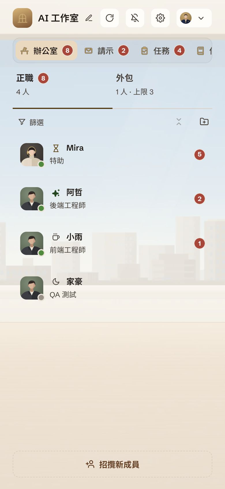

# Use it on your phone

This page explains how your phone connects to the console, which features you can use on your phone, and push notifications.

## Letting your phone reach the console

The console **only accepts connections from the computer OffiCraft is installed on**, and this cannot be changed. To connect from your phone, tell Mira "**I want to reach the console from somewhere other than this computer**". Mira sets up a forwarding tool and gives you the address to use on your phone.

- **Turn on two-factor authentication before opening access.** Anyone who has the address can open the sign-in page. A passkey does not replace two-factor authentication: even with a passkey, you can still sign in with only the password.
- **Your phone cannot reach the console while the computer is shut down or asleep.**

## Signing in on your phone

On your phone you sign in the same way as on the computer, with your password and two-factor authentication. You can also add a passkey and sign in with Face ID or a fingerprint instead. **Add the passkey on your phone, using the forwarded address.** A passkey added on the computer through a `localhost` address does not work on your phone.

## Home screen and push notifications

- **Add to Home Screen**: use "Share › Add to Home Screen" in Safari or "Add to Home screen" in the Chrome menu. After that, the console opens full screen like a standalone app.
- **Push notifications**: when there is a new message or an ask that needs your decision, this device gets a notification. Tapping the notification takes you back to the matching chat or the Ask page. Fill in "Notification email" in the Profile menu, then tap the bell icon at the top to turn notifications on.

Keep in mind:

- **On iPhone and iPad, add the console to the Home Screen first.** You can only turn on notifications after opening the console from the Home Screen, and the system must be iOS/iPadOS 16.4 or later.
- Each device has to turn notifications on separately.
- Your notification email is given to the push service run by your browser's maker; it does not stay only on your server.

## The phone layout

The phone has the same features as the computer, but shows one area at a time: "Office" first shows the member list, and tapping a member opens its chat; "Ask" lets you answer reply cards directly; "Task" shows each task's status, steps, and notes.

## Related docs

- [Protect your studio](security.md)
- [Assigning work and answering reply cards](daily.md)
- [Tracking task progress](tasks.md)
- [Troubleshooting and FAQ](troubleshooting.md)
