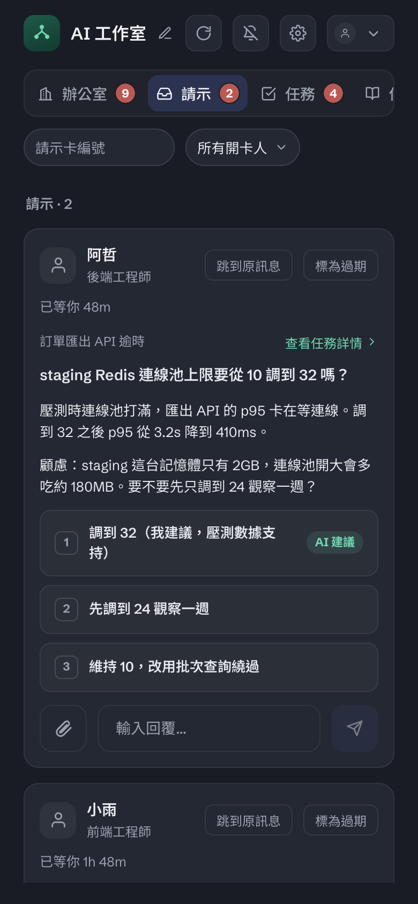
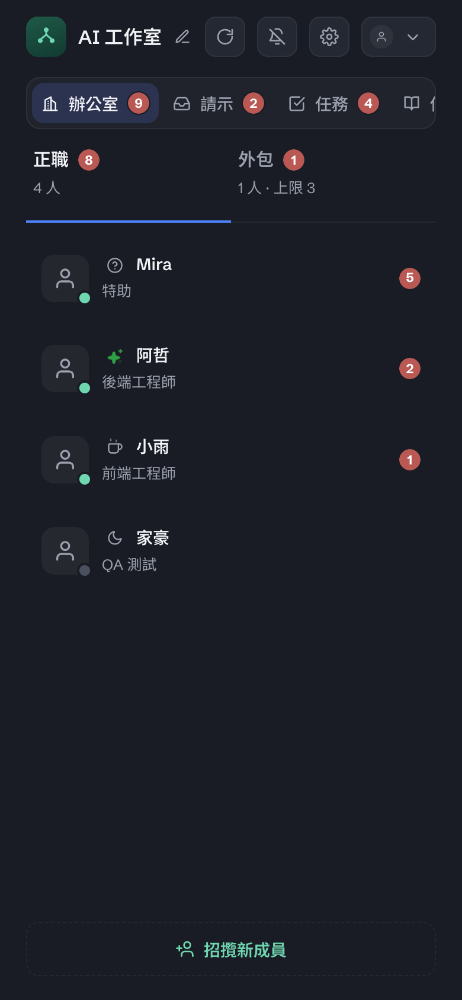

# 在手機上用

讀完這頁，你能讓手機連上控制台、第一次就順利登入、把控制台加到主畫面並收到推播通知，在手機上回覆請示卡、看任務進度和跟成員聊天。

兩張截圖拍攝時主導覽只有四個分頁；現在依序是辦公室、請示、任務、傳承、密鑰、監控、使用說明，手機上分頁列放不下時可以左右滑動。

## 讓手機連得到控制台

OffiCraft 的伺服器預設只接受本機（`127.0.0.1`）的連線，所以手機要連，需要你自己開一條通道：

- **tunnel**（例如 cloudflared）：給你一個公開的 HTTPS 網址，手機在任何地方都連得到。
- **VPN 或 Tailscale 這類私有網路**：只讓你自己的裝置互連，不開公開網址。

不要把伺服器直接開在沒有 HTTPS 的公開連接埠上。開 tunnel 之前，先設一組夠強的密碼並開啟兩步驟驗證，因為通道打開後，任何知道網址的人都能試著登入。密碼、兩步驟驗證與通行密鑰的設定，見 [保護你的工作室](security.md)。

## 第一次在手機上登入

最省事的方式是一次性登入連結，不用在手機上打密碼和驗證碼：

1. 在執行 OffiCraft 伺服器的那台電腦上，第一次使用前先執行 `ocserverd login-link enable`，開放這項功能。
2. 執行 `ocserverd login-link --base-url https://你的tunnel網址`，畫面會印出一條登入連結。
3. 把連結傳到手機（例如用 AirDrop 或傳給自己的訊息）並打開，就會直接登入。

這條連結 10 分鐘內有效，只能用一次；再產生一條新的，舊的就失效。連結等同你的登入權限，只傳給你自己。不需要這項功能時，執行 `ocserverd login-link disable` 關閉。

也可以直接在手機上用密碼登入（有開兩步驟驗證時再輸入驗證碼）。登入後，可以在手機上新增一把通行密鑰，之後用 Face ID 或指紋登入。通行密鑰綁在註冊時的網址，要在手機上用 tunnel 網址打開控制台後再新增，做法見 [保護你的工作室](security.md)。

## 加到主畫面

iPhone 或 iPad：

1. 用 Safari 打開控制台網址。
2. 點下方工具列的「分享」。
3. 選「加入主畫面」，取一個你認得的名字，按「加入」。

Android（Chrome）：右上角選單選「加到主畫面」。

之後從主畫面點開，控制台會以獨立 App 的形式全螢幕開啟，沒有網址列。

## 開啟推播通知

開啟後，有新訊息或需要你決定的請示時，這台裝置會收到通知；點通知會回到對應的聊天室或請示頁。

1. 先在右上角頭像選單的「通知信箱」填一個信箱。沒填的話無法開啟通知，畫面會寫「請先在個人選單的「通知信箱」填入通知信箱。」通知信箱會提供給瀏覽器的推播服務，請用可以公開的信箱。
2. 點頂端的鈴鐺圖示（「開啟通知」）。鈴鐺上有斜線表示這台裝置還沒開啟通知。
3. 瀏覽器詢問時選「允許」。開啟後鈴鐺的斜線消失，再點一次可以「關閉通知」。

注意：

- 每台裝置要各自開啟一次。
- iPhone、iPad 需要 iOS／iPadOS 16.4 以上，而且必須先加到主畫面、從主畫面打開後才能開啟通知。
- 鈴鐺沒有出現，表示目前使用的瀏覽器不支援推播，或通知權限已被封鎖。被封鎖時，到瀏覽器或系統設定重新允許 OffiCraft 的通知。
- 通知只用來提醒，控制台沒有離線模式，沒有網路時無法使用。

## 手機上的畫面

手機和電腦的功能相同，版面改成一次只顯示一個區塊：

- 「辦公室」先顯示成員名單，點成員進入聊天室，按「返回成員」回到名單。
- 「請示」可以直接回覆請示卡：序號開頭的是單選卡，點一下選項就送出；勾選框開頭的是多選卡，勾好再送出。
- 「任務」看每張任務的狀態、步驟和備註。
- 聊天可以傳照片、貼上截圖，也可以打開成員傳來的圖片與文件。

各項操作的說明見 [交代工作與回覆請示卡](daily.md) 和 [追蹤任務進度](tasks.md)。

## 相關文件

- [保護你的工作室](security.md)
- [交代工作與回覆請示卡](daily.md)
- [常見問題與排解](troubleshooting.md)
