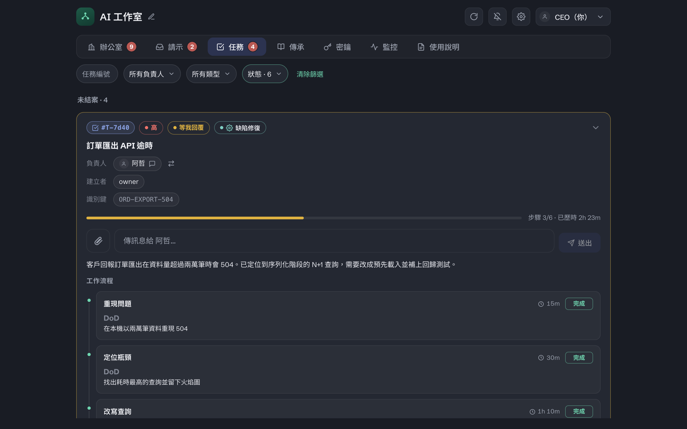

# 追蹤任務進度

讀完這頁，你能看懂任務卡上的狀態與步驟、知道成員什麼時候會停下來等你，並在需要時凍結、終止、轉派或結案一張任務。

## 任務怎麼產生

你在聊天室交代一件事，成員判斷需要開成任務時，會先查有哪些任務手冊適用，然後**先開一張請示卡請你確認**，卡上寫明：

- 任務名稱與要解決的問題
- 任務類型（對應哪一本任務手冊；沒有合適的手冊時寫「自由代辦」）
- 完成條件（AC）：完成時可以觀察、可以驗證的結果
- 由誰執行，以及執行的機器、模型與投入程度

你回覆確認後，成員才會建立任務。你可以在回覆裡修改其中任何一項，成員會照你確認的內容建立。

任務由誰執行，依任務手冊的「負責成員」決定：手冊指定某位成員，就由那位成員執行；手冊指定外包，任務會交給外包執行；沒有適用的手冊，任務會成為「自由代辦」，由開任務的成員自己執行。任務手冊怎麼寫，見 [讓 AI 照 SOP 做重複的事](sop.md)。

任務手冊設了識別鍵時，同一類型裡識別鍵的值相同、而且還沒結案的任務會被視為同一件事，不會再開第二張。比對時只去掉前後空白，大小寫也要完全相同。任務結案後，同一個值再進來會開新的一張。自由代辦和沒有設識別鍵的類型不會自動去重。

外部事件（例如 Slack、GitHub 送來的通知）和定期訊息也可能讓成員開任務，流程相同。設定方式見 [讓外部事件自動送給成員](webhook.md) 和 [每天固定做某件事](schedule.md)。

## 在任務頁找到任務

「任務」分頁先列未結案的任務，再列已結案的任務，分頁上的數字是未結案的任務數。上方的篩選列有「任務編號」「所有負責人」「所有類型」「狀態」「所有到期」五個欄位。「狀態」預設只勾選還沒結案的狀態，按鈕上寫「未結案」；選單最上面的「未結案」「已結案」兩列可以一次勾選或取消一整組狀態。因為狀態預設就有篩選，欄位後面一開始就有「清除篩選」，按下去會清掉全部條件，包括狀態，已完成與已終止的任務也會列出來。

「所有到期」可以勾選「已逾期」「快到期」，只列出符合的未結案任務。篩選列最右邊的「顯示方式」裡有「分組依據」，可以選不分組、到期狀態、優先權、負責人、類型或狀態。選「到期狀態」時，任務分成「已逾期」「即將到期」「之後到期」「沒有到期日」幾組，組內依到期日由早到晚排列；已結案的任務也依到期日分組。每一組都可以收合，預設只展開第一組。分組依據會記在這個瀏覽器上。

每張任務卡上有：

- **任務編號**：點一下可以「複製任務編號」。
- **優先權**：高、中、低，或凍結。
- **到期日**：在「建立者」下面一列，顯示日期，有指定時間時加上時間，後面接「· 還有 5 天」或「· 已逾期 2 天」；剩不到一天時改用小時，不到一小時時改用分鐘。快到期的任務顯示為橘黃色，已逾期的顯示為紅色。已結案的任務只顯示日期。還沒設定時寫「未設定」。
- **狀態**：任務目前所在的階段，各狀態的意思列在「任務的狀態」。
- **任務類型**：旁邊的「開啟任務類型設定」會打開對應的任務手冊。
- **負責人**：目前執行任務的成員。負責人是外包時，會一併顯示外包的代號、模型與投入程度。
- **建立者**：建立任務的人。建立者就是負責人時不顯示。
- **前任**：任務轉派過時，上一位負責人。
- **識別鍵**：用來去重的值，是網址時可以點開。
- **步驟 完成數/總數 · 已歷時**：進度與已經花的時間。

點到期日（滑鼠移上去顯示「設定到期日」）會打開一個小框，可以選日期、時間（「不指定時間」表示當天結束前都不算逾期）和「快到期提醒」（數字加上天、小時或分鐘，再接「前」）。「快到期提醒」留空時沿用全站設定，數字欄位會以淡灰字顯示全站設定的值；全站設定在 設定 › 參數調整。按 ✓「套用」、按 Enter 或點到小框外就儲存；按 ✗「取消」或 Esc 不儲存。日期旁的 ✕「清除到期日」會清空日期，儲存後就拿掉到期日。能改到期日的人和優先權相同：你、特助 Mira 和負責人；已結案的任務不能改。成員開任務時也可以一併設定到期日，之後同樣能修改或清除。

卡上的訊息框可以直接「傳訊息給負責人」，也有「傳訊息給建立者」「傳訊息給前任」。

## 任務的狀態

| 狀態 | 意思 |
| --- | --- |
| 尚未執行 | 任務已建立，還沒開始做。 |
| 進行中 | 成員正在推進。 |
| 等我回覆 | 有一張綁在步驟上的請示卡在等你回覆。 |
| 等待外部 | 在等第三方：權限還沒開、對方還沒回信、時間還沒到。 |
| 可結案 | 所有步驟都完成了，正在等負責人收尾。 |
| 已完成 | 已結案。 |
| 終止 | 已結案，任務被中止，不再做。 |
| 重複 | 已結案，任務和另一張任務是同一件事。 |

前五種狀態由步驟自動推算，不需要任何人手動設定；後三種是結案狀態，只有結案動作會產生，任務不會自己結案。

- **等我回覆**：一張任務可以同時有好幾張請示卡在等你，只要還有一張沒回覆，任務就維持等我回覆。回覆後，任務回到依步驟推算出的狀態，可能是進行中、等待外部或可結案。
- **等待外部**：只用在事情不在成員手上時。等 CI 跑完、等測試結果屬於成員自己的工作，算進行中。成員把步驟設成等待外部時會寫下等待原因，顯示在該步驟上。
- **可結案**：負責人收尾完成並結案前，任務一直停在可結案，沒有時限。收尾期間如果新增步驟，任務會回到進行中。

任務卡上可能同時出現「轉派中」。轉派中不是狀態，表示任務正在換負責人，新負責人接手或任務結案後就消失。所以一張任務可以同時是「進行中」和「轉派中」。

## 步驟與完成定義

任務建立後，負責人依完成條件與任務手冊，把任務拆成幾個步驟（卡上的「工作流程」）。每個步驟有名稱和一句完成定義（DoD）。DoD 必須填寫，空白的計畫送不出去；但寫得好不好要靠內容本身，好的 DoD 寫的是做完後看得到的結果，例如「全部測試通過」，而不是「跑一下測試」。

步驟的狀態有：待辦、進行中、完成、等我回覆、等待外部、已取代。

- **同時進行**：互不相關的步驟可以並行，卡上標示「同時進行 · N 項並行」。
- **備註**：負責人在步驟上留的進度紀錄，按「展開備註」閱讀。任務停著沒動時，先看最近的備註，通常比再問一次快。成員換手時，接手的成員也是從這裡知道做到哪裡。任務結案後備註就不能再寫。
- **依賴**：任務被另一張任務擋住時，卡上顯示「等 T-xx」，按「跳到 T-xx」看擋住它的任務。依賴只是標示，不會改變狀態。

負責人可以在途中新增、刪除單一步驟或調整順序，不影響其他步驟的備註與請示卡。負責人也可能整份重新規劃，這時：

- 已完成的步驟保留。
- 還沒完成、但綁的請示卡已經回覆或標為過期的步驟：新計畫裡有同名步驟就保留；沒有的話改為「已取代」，保留當時的問答紀錄。
- 其他還沒完成的步驟會被移除，步驟上的備註也一起移除。

「已取代」的步驟不計入「步驟 完成數/總數」，所以重新規劃不會讓進度數字突然增加或倒退。成員不能直接把步驟設成已取代。

## 什麼時候會停下來等你

有些步驟需要你決定、核可或驗收，成員規劃時會把這些步驟設成關卡，卡上標著「審批」。你在計畫送出時就能看到這件事之後哪幾步需要你。走到關卡時，成員會開一張請示卡，任務變成「等我回覆」。

不是只有關卡會開卡。任何還沒完成的步驟，成員遇到需要你決定的事，都可以當場開一張請示卡停下來等你；這不會讓該步驟變成關卡。任務在進行中、等我回覆或等待外部時都能開卡，步驟已經完成或任務已經結案時則不能。

成員針對別人負責的任務開卡時，卡片不會綁在步驟上，任務也不會因此停下；你回覆後，被問到的任務的負責人會收到通知。

請示卡會出現在任務卡的「請示」區塊、「請示」分頁和聊天室，回覆方式見 [交代工作與回覆請示卡](daily.md)。卡上的「查看等我回覆卡」和「查看等待外部節點」可以直接跳到停住的地方。

## 凍結、終止、標記重複與轉派

- **凍結**：在「優先權」選「凍結」，成員就停止推進任務。你、特助 Mira 和負責人都能凍結與解凍。成員要恢復一張被凍結的任務前，會先開卡徵求你同意。
- **終止**：在「狀態操作」選「終止」，再按「確認終止」。任務結案為終止，無法恢復，負責人會收到通知並收尾。
- **標記重複**：在「狀態操作」選「標記重複」，選原票，再按「確認標記重複」。任務結案為重複，無法恢復，卡上顯示「重複於」並可「跳到原票」。成員發現自己的任務和別張重複時也會這樣做。
- **轉派**：按任務卡「負責人」旁的交換圖示（滑鼠移上去顯示「轉派…」），選「轉給成員」或「轉外包」，可以寫交接備註，再按「確認轉派」。任務會進入轉派中，前後兩位負責人都會收到交接通知。

## 產物

成員把需要你查看、使用或驗收的成果掛在任務卡上，稱為產物，可以是檔案、圖片或連結。按「查看產物」打開清單；文字檔可以「查看版本」，在「內容」和「差異」之間切換，看每一版改了什麼。「移除產物」會保留目前的檔案，但舊版本會永久刪除。

從產物打開的文件可以直接寫註解送回負責人，做法見 [交代工作與回覆請示卡](daily.md)。任務結案後，產物就不能再新增或更換。

## 結案

所有步驟完成後，任務進入可結案，負責人會依序收尾：

1. 把需要驗收的成果掛成產物，驗證結果寫回任務。
2. 開一張請示卡請你驗收。你還沒回覆、要求修改或仍有待辦事項時，任務不會結案。
3. 驗收通過後，判斷有沒有值得留下的經驗，有的話寫成傳承（見 [讓成員記住你教過的事](lore.md)）。
4. 清掉暫存檔與自己開啟的外部資源，把用不到的請示卡標為過期。
5. 把任務結案為已完成。

步驟還沒做完、但你決定不再繼續時，可以在「狀態操作」選「強制結案」，理由可以不填，再按「確認強制結案」。強制結案只有你和特助能做，任何未結案的任務都可以，結案後卡上顯示「強制結案」與理由（沒填時寫「未填理由」），無法復原。

## 相關文件

- [交代工作與回覆請示卡](daily.md)
- [讓 AI 照 SOP 做重複的事](sop.md)
- [增加成員與發外包](members.md)
- [名詞表](glossary.md)
