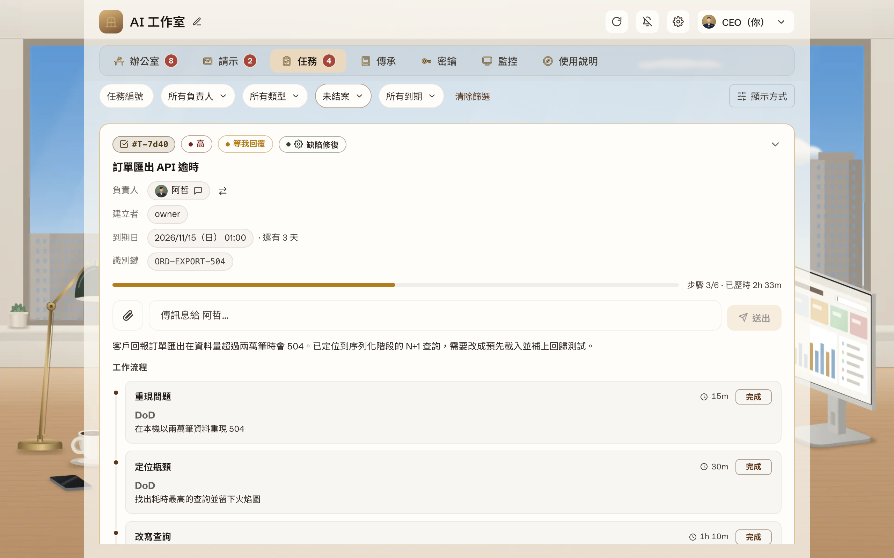

# 追蹤任務進度

這頁說明任務裡有哪些東西，以及各自代表什麼意思。

## 任務

任務是一件分成多個步驟、有明確完成條件的工作。簡單的事成員會直接在聊天室回覆；想用任務追蹤，交代時直接說「建一張任務」。

- **完成條件（AC）**：整張任務做完時要達成、可以檢查的結果。
- **任務類型**：任務照哪一本任務手冊做；沒有適用的手冊時顯示「自由代辦」。任務手冊見 [讓 AI 照 SOP 做重複的事（任務手冊）](sop.md)。
## 任務卡

「任務」分頁列出所有任務，分頁上的數字是還沒結案的任務數。每張任務卡上有：

- **狀態**：任務走到哪個階段，見下一節。
- **負責人**：現在做這張任務的成員。
- **優先權**：任務的先後順序；選「凍結」時，成員停止推進這張任務。
- **到期日**：快到期或已逾期時會變色。
- **步驟 完成數/總數**：做完幾步、總共幾步。
- **訊息框**：直接傳訊息給負責人。

各欄位的完整說明見 [介面說明](interface.md) 的「任務」。

## 狀態

| 狀態 | 意思 |
| --- | --- |
| 尚未執行 | 任務已建立，還沒開始做。 |
| 進行中 | 成員正在推進。 |
| 等我回覆 | 有一張綁在步驟上的請示卡在等你回覆，任務停在那一步。 |
| 等待外部 | 在等第三方，例如權限還沒開、對方還沒回信、時間還沒到。 |
| 可結案 | 所有步驟都完成了，正在等負責人收尾。 |
| 已完成 | 已結案。 |
| 終止 | 已結案，任務被中止，不再做。 |
| 重複 | 已結案，任務和另一張任務是同一件事。 |

任務卡上出現「轉派中」，表示任務正在換負責人。

## 步驟

任務卡的「工作流程」列出負責人拆好的步驟：

- **完成定義（DoD）**：每個步驟做到什麼程度才算完成。
- **關卡**：需要你決定、核可或驗收的步驟，一開始就標著「等我回覆」。走到關卡時，成員會開請示卡給你。
- **備註**：負責人在步驟上記下的進度與結果。

## 產物

產物是負責人放在任務卡上、要給你看或驗收的成果，可以是檔案、圖片或連結。文字檔可以看每一版改了什麼。

**移除產物會永久刪除舊版本**，目前的檔案則會保留。

## 結束或改變一張任務

- **已完成**：所有步驟完成、你驗收通過後，負責人結案。
- **強制結案**：步驟還沒做完，但你決定不再繼續。**無法復原**。
- **終止**：中止任務，不再做。**無法恢復**。
- **標記重複**：指出原本那張任務，這張任務結案為「重複」。**無法恢復**。
- **凍結**：暫停任務，成員要恢復前會先開卡問你。
- **轉派**：把任務交給另一位成員或外包。

強制結案、終止、標記重複都在任務卡的狀態標籤上；凍結在「優先權」；轉派在「負責人」旁。

## 相關文件

- [交代工作與回覆請示卡](daily.md)
- [讓 AI 照 SOP 做重複的事（任務手冊）](sop.md)
- [增加成員與發外包](members.md)
- [名詞表](glossary.md)
