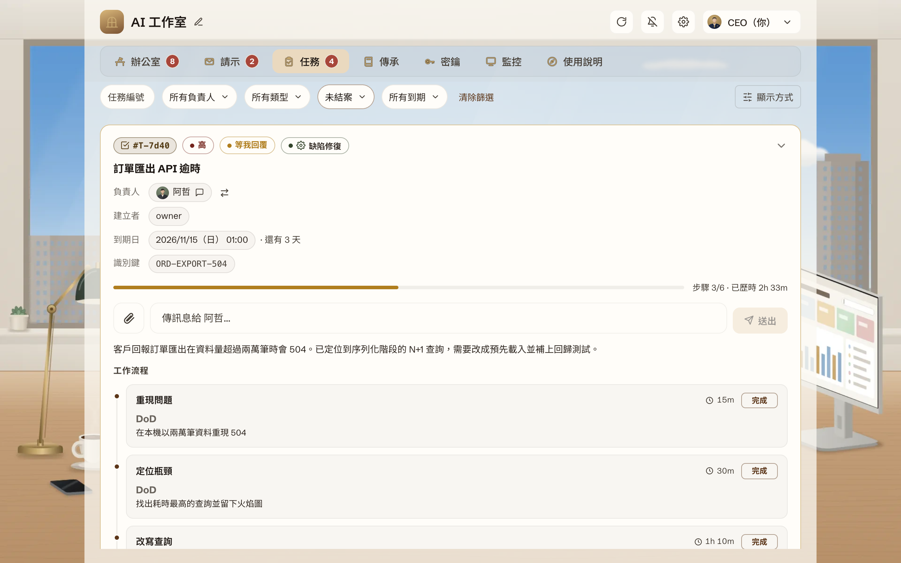

# Tracking task progress

This page explains what a task contains and what each part means.

## Tasks

A task is a piece of work divided into several steps, with clear acceptance criteria. For simple requests, a member replies directly in the chat. If you want to track something as a task, say "create a task" when you give the work.

- **Acceptance criteria (AC)**: results that can be checked and that must be reached when the whole task is finished.
- **Task type**: which task manual the task follows. If no manual applies, it shows "Ad-hoc". For task manuals, see [Having AI follow an SOP for repeated work (Task manuals)](sop.md).
## Task cards

The "Task" tab lists all tasks. The number on the tab is the number of tasks that are not yet closed. Each task card shows:

- **Status**: which stage the task has reached, shown as an icon at the start of the card; hover over it to see the status name. See the next section.
- **Assignee**: the member currently working on the task.
- **Priority**: the order in which tasks are handled. When "Frozen" is selected, the member stops moving this task forward.
- **Due date**: changes color when the task is Due soon or Overdue.
- **Step done/total**: how many steps are done and how many there are in total.
- **Message box**: send a message directly to the assignee.

For a full description of each field, see "Task" in [Interface reference](interface.md).

## Status

| Status | Meaning |
| --- | --- |
| Not started | The task has been created but work has not started. |
| In progress | The member is moving the task forward. |
| Awaiting my reply | A reply card attached to a step is waiting for your reply, and the task is stopped at that step. |
| Waiting on external | Waiting on a third party, for example access that has not been granted yet, an email that has not been answered yet, or a time that has not arrived yet. |
| Ready to close | All steps are complete, and the task is waiting for the assignee to wrap it up. |
| Done | Closed. |
| Terminated | Closed. The task was stopped and will not be done. |
| Duplicate | Closed. The task is the same piece of work as another task. |

When "Reassigning" appears on a task card, the task is being handed to a different assignee.

## Steps

The "Workflow" on a task card lists the steps the assignee has broken the task into:

- **Definition of done (DoD)**: how far a step must go before it counts as complete.
- **Gate**: a step that needs your decision, approval, or acceptance. It is marked "Approval" from the start. When the task reaches a gate, the member opens a reply card for you. A step a member opens a reply card on becomes a gate too.
- **Note**: progress and results that the assignee records on the step.

## Artifacts

Artifacts are results the assignee places on the task card for you to review or accept. They can be files, images, or links. For text files, you can see what changed in each version.

**Removing an artifact permanently deletes its older versions.** The current file is kept.

## Ending or changing a task

- **Done**: after all steps are complete and you have accepted the result, the assignee closes the task.
- **Force close**: steps are not finished, but you decide not to continue. **This cannot be undone.**
- **Terminate**: stop the task; it will not be done. **This cannot be undone.**
- **Mark duplicate**: search by Task ID or title to point to the original task. This task is closed as "Duplicate". **This cannot be undone.**
- **Frozen**: pause the task. Before resuming it, the member opens a card to ask you.
- **Reassign**: hand the task to a different member or to an outsource member.

Force close, Terminate, and Mark duplicate are in the menu that opens when you click the status icon at the start of the task card. Frozen is under "Priority". Reassign is next to "Assignee".

## Related pages

- [Assigning work and answering reply cards](daily.md)
- [Having AI follow an SOP for repeated work (Task manuals)](sop.md)
- [Adding members and hiring outsource](members.md)
- [Glossary](glossary.md)
